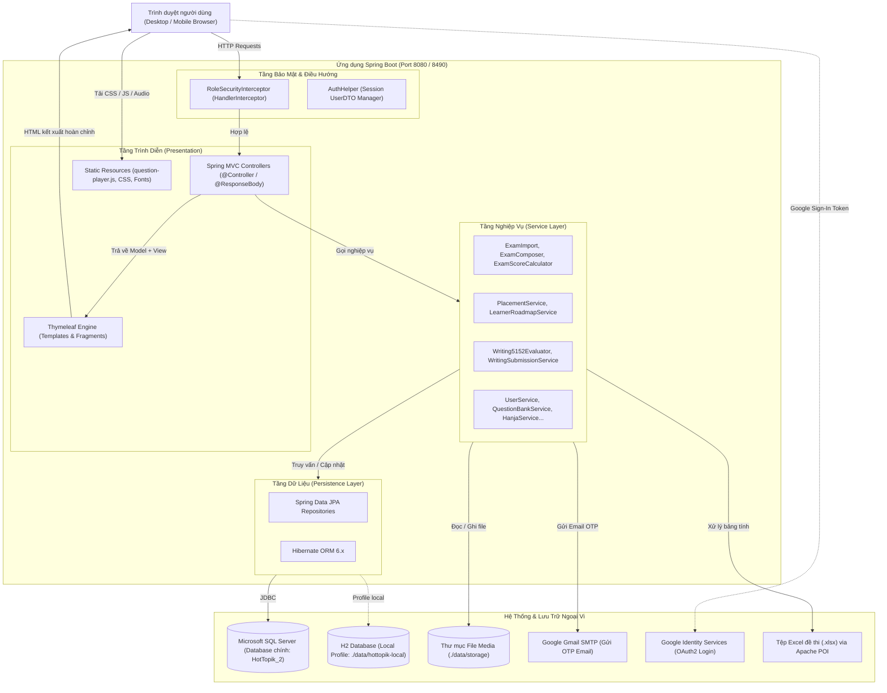

# 02 - KIẾN TRÚC HỆ THỐNG (SYSTEM ARCHITECTURE)

> **Trạng thái**: Đã xác minh trong mã nguồn thực tế (pom.xml, config, web mvc, properties).

---

## 1. Cấu Trúc Tổng Thể (High-Level Architecture)

HOT TOPIK được xây dựng theo mô hình **Monolithic 3 tầng (3-Tier Layered Architecture)** hiện đại, áp dụng mô hình **MVC (Model-View-Controller)** với cơ chế kết xuất phía máy chủ (**Server-Side Rendering - SSR**) kết hợp các tương tác bất đồng bộ (AJAX/Fetch) ở phía máy khách.



---

## 2. Tổ Chức Mã Nguồn (Source Code Structure)

Toàn bộ mã nguồn nằm trong gói gốc `com.hottopik`:

```
d:\SEP490_G25\HotTopik\
├── pom.xml                                   # Cấu hình dự án Maven & Dependencies
├── src\main\
│   ├── java\com\hottopik\
│   │   ├── config\                          # Cấu hình MVC, Security Interceptor, Schema
│   │   ├── controller\                      # 24 Controllers phân chia theo chức năng và phân hệ
│   │   ├── dto\                             # DTO truyền dữ liệu giữa Controller - View / API
│   │   ├── entity\                          # 30+ Thực thể JPA & Enum
│   │   │   └── exam\                        # Các Entity và Enum chuyên biệt cho đề thi & ngân hàng câu hỏi
│   │   ├── repository\                      # Spring Data JPA Repositories
│   │   │   └── exam\                        # Repositories quản lý đề thi, câu hỏi, lộ trình
│   │   ├── service\                         # Các Service xử lý logic nghiệp vụ chính
│   │   │   └── exam\                        # Core logic đề thi: import, tính điểm, placement, roadmap, viết 51-52
│   │   └── util\                            # Tiện ích: AuthHelper, Password hashing, v.v.
│   └── resources\
│       ├── application.properties           # Cấu hình chạy chính (SQL Server, Port 8080, SMTP)
│       ├── application-local.properties     # Cấu hình chạy offline (H2 Database, Port 8490)
│       ├── db\                              # Script khởi tạo và vá schema CSDL
│       ├── static\
│       │   ├── css\                         # CSS hệ thống (question-player.css, content-admin.css...)
│       │   └── js\                          # JavaScript tương tác client (question-player.js...)
│       └── templates\                       # Giao diện HTML Thymeleaf
│           ├── admin\                       # Cổng Quản trị viên
│           ├── auth\                        # Đăng ký, đăng nhập, quên mật khẩu
│           ├── content\                     # Cổng Quản lý nội dung (đề thi, từ vựng, ngữ pháp)
│           ├── exam\                        # Giao diện làm bài thi và xem kết quả
│           ├── fragments\                   # Thành phần dùng chung (navbar, head, player, toolbar)
│           ├── learner\                     # Trang chủ học viên, lịch sử làm bài
│           ├── operation\                   # Cổng Quản lý vận hành & xử lý báo lỗi
│           ├── placement\                   # Bài kiểm tra năng lực đầu vào
│           ├── practice\                    # Luyện tập theo dạng câu hỏi
│           ├── roadmap\                     # Lộ trình học cá nhân hóa
│           ├── teacher\                     # Cổng Giảng viên chấm bài viết
│           ├── theory\                      # Kho lý thuyết (Từ vựng, Ngữ pháp, Hanja)
│           └── writing\                     # Phòng luyện kỹ năng Viết
└── data\
    └── storage\                             # Thư mục lưu trữ file tải lên (MP3, ảnh câu hỏi)
```

---

## 3. Các Layer và Trách Nhiệm (Layer Responsibilities)

### 3.1. Controller Layer (`com.hottopik.controller`)
- **Trách nhiệm**: Nhận HTTP Request (GET/POST), trích xuất tham số, kiểm tra xác thực người dùng trong phiên (`HttpSession`), gọi các Service phù hợp, đưa dữ liệu vào Spring `Model` và trả về tên view template Thymeleaf hoặc dữ liệu JSON.
- **Nguyên tắc**: Không đặt logic nghiệp vụ tính toán điểm số hoặc truy vấn CSDL phức tạp tại Controller. Mọi hành vi làm thay đổi dữ liệu đều thông qua Service.

### 3.2. Service Layer (`com.hottopik.service`)
- **Trách nhiệm**: Chứa 100% quy tắc nghiệp vụ, tính toán điểm số, thuật toán xếp lớp, tạo lộ trình học, bóc tách file Excel, đánh giá quy chuẩn bài viết câu 51-54, quản lý giao dịch CSDL thông qua `@Transactional`.
- **Xử lý lỗi**: Ném ra các ngoại lệ có ý nghĩa nghiệp vụ như `ExamDomainException` hoặc Spring `ResponseStatusException` thay vì để lọt `NullPointerException` hay lỗi cơ sở dữ liệu thô ra màn hình.

### 3.3. Repository Layer (`com.hottopik.repository`)
- **Trách nhiệm**: Kế thừa `JpaRepository<Entity, ID>` để thực hiện CRUD. Các câu truy vấn tùy biến sử dụng JPQL `@Query` với cú pháp tường minh (`join fetch`) nhằm tối ưu hiệu năng và tránh lỗi N+1 Query.

### 3.4. Entity Layer (`com.hottopik.entity`)
- **Trách nhiệm**: Ánh xạ quan hệ thực thể với các bảng cơ sở dữ liệu thông qua Hibernate JPA Annotations (`@Entity`, `@Table`, `@Id`, `@ManyToOne`, `@Enumerated(EnumType.STRING)`).

### 3.5. View Layer (`templates/` & `static/`)
- **Trách nhiệm**: Thymeleaf kết xuất giao diện trực tiếp trên Server với các fragment dùng chung. Client script sử dụng Vanilla JS tối ưu hóa trải nghiệm làm bài thi (`question-player.js`), xử lý phím tắt, bấm giờ đếm ngược, tự động lưu câu trả lời (autosave) và IntersectionObserver để đánh dấu số câu đang làm.

---

## 4. Cơ Chế Xác Thực & Phân Quyền (Authentication & Authorization)

Hệ thống **không sử dụng cấu hình Spring Security Filter Chain cồng kềnh** mà áp dụng kiến trúc gọn nhẹ, kiểm soát phiên trực tiếp:

1. **Lưu trữ phiên (Session Management)**:
   - Khi đăng nhập thành công, thông tin người dùng được chuyển đổi thành `UserDTO` và lưu vào `HttpSession` qua `session.setAttribute("USER_SESSION", userDto)` (hoặc thông qua tiện ích `AuthHelper`).
   - Cookie phiên: `JSESSIONID` tiêu chuẩn của Servlet container.

2. **Kiểm soát truy cập theo vai trò (Role-Based Access Control)**:
   - Được thực thi tại `RoleSecurityInterceptor` đăng ký trong `WebMvcConfig`.
   - Mọi request đều đi qua `preHandle()` để kiểm tra tiền tố URL:
     - `/admin/**`: Bắt buộc tài khoản có quyền `isAdmin()`. Riêng `/admin/vocabulary` cho phép thêm `isContentManager()`.
     - `/content/**`: Bắt buộc `isContentManager()` hoặc `isAdmin()`.
     - `/operation/**`: Bắt buộc `isOperationManager()` hoặc `isAdmin()`.
     - `/teacher/**`: Bắt buộc `isMentor()` (Giáo viên) hoặc `isAdmin()`.
     - Nếu chưa đăng nhập: Tự động điều hướng về `/login?unauthorized=1`.
     - Nếu sai quyền: Tự động từ chối truy cập.

3. **Mã hóa mật khẩu (Password Hashing)**:
   - Sử dụng thư viện `spring-security-crypto` với thuật toán `BCryptPasswordEncoder` để băm mật khẩu khi người dùng đăng ký hoặc đổi mật khẩu.

---

## 5. Các Thành Phần Tích Hợp Ngoại Vi

1. **Cơ sở dữ liệu Microsoft SQL Server**:
   - Sử dụng driver `com.microsoft.sqlserver.mssql-jdbc`.
   - Kết nối vào cơ sở dữ liệu `HotTopik_2` trên cổng mặc định `1433`.
   - Cơ chế cập nhật bảng tự động: `spring.jpa.hibernate.ddl-auto=update`.

2. **Cơ sở dữ liệu H2 (Chế độ chạy offline / Local Profile)**:
   - Kích hoạt qua cờ `-Dspring-boot.run.profiles=local`.
   - Lưu trữ dạng file tại `./data/hottopik-local.mv.db` với chế độ tương thích `MODE=MSSQLServer`.
   - Cho phép toàn bộ đội ngũ lập trình và AI chạy ứng dụng ngay trên máy local mà không cần cài đặt SQL Server.

3. **Dịch vụ Email Google SMTP**:
   - Tích hợp thông qua `spring-boot-starter-mail`.
   - Kết nối máy chủ `smtp.gmail.com:587` qua giao thức STARTTLS.
   - Sử dụng để gửi mã OTP kích hoạt tài khoản và mã xác thực đặt lại mật khẩu.

4. **Xác thực Google OAuth2**:
   - Sử dụng Google Identity Services (Client ID cấu hình trong `application.properties`).
   - Xác thực danh tính người dùng và đồng bộ tài khoản tự động vào CSDL.

5. **Xử lý tài liệu Excel (Apache POI 5.2.5)**:
   - Đọc và phân tích cấu trúc các file bảng tính `.xlsx` mẫu đề thi TOPIK chuẩn do đội ngũ Content tải lên.
   - Xuất dữ liệu báo cáo và file mẫu import.

6. **Lưu trữ Tệp Media Cục Bộ (Local File Storage)**:
   - Toàn bộ file âm thanh đề nghe (`.mp3`) và hình ảnh câu hỏi (`.png, .jpg`) được lưu trữ tại đường dẫn cấu hình `hottopik.storage.dir=./data/storage`.
   - Endpoint phục vụ media: `/content/media/{sourceId}/{filename}` hỗ trợ stream audio và hiển thị hình ảnh trực tiếp trên trình duyệt.
