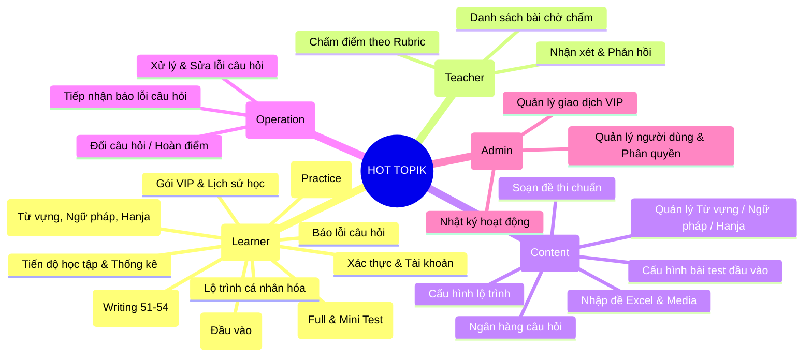

# 03 - DANH SÁCH MODULE VÀ CHỨC NĂNG (FUNCTIONAL MODULES)

> **Trạng thái**: Đã xác minh trong Controllers, Services và Templates của dự án.

---

## 1. Bản Đồ Tổng Quan Các Phân Hệ (Module Landscape)

Hệ thống HOT TOPIK được chia thành 15 phân hệ chức năng rõ ràng:

---

## 2. Chi Tiết Từng Module Chức Năng

### Module 1: Xác Thực & Tài Khoản (Auth & Profile)
- **Controller liên quan**: `AuthController.java`, `OnboardingController.java`, `LearnerController.java`.
- **Chức năng**:
  - Đăng ký tài khoản mới bằng Email, mật khẩu được mã hóa BCrypt.
  - Gửi mã OTP xác thực email thông qua Gmail SMTP (`EmailService.java`).
  - Đăng nhập hệ thống bằng Email/Mật khẩu hoặc Google OAuth2.
  - Quên mật khẩu & Đặt lại mật khẩu qua mã OTP xác minh qua Email.
  - Xem và cập nhật thông tin cá nhân: Họ tên, ảnh đại diện, số điện thoại, mục tiêu TOPIK, thời gian học mục tiêu hàng ngày (`dailyGoalMinutes`).
  - **Thanh điều hướng & Hướng dẫn sử dụng (`navbar.html`, `walkthrough-tour.js`, `help-modal.html`)**: Topbar chuẩn hóa chiều cao `36px` đồng bộ cho các tác vụ (`Xu`, `VIP`, Chuông thông báo, Avatar; đã bỏ pill `"Đã học ... ngày"` khỏi topbar), tích hợp nút **Trợ giúp `(?)`** (`#htHelpToggleBtn`) cung cấp menu xem Tour 11 trạm, hướng dẫn nhanh trang hiện tại, Cẩm nang tính năng hữu ích (Báo lỗi, Khiếu nại, Tự động lưu, Đổi Xu) và đánh giá hệ thống.
- **Actor**: Guest, Learner, Teacher, Content Manager, Operation Manager, Admin.
- **Trạng thái**: **ĐÃ HOÀN THÀNH**.

### Module 2: Đánh Giá Năng Lực Đầu Vào (Placement Test)
- **Controller liên quan**: `PlacementController.java`, `ContentPlacementController.java`.
- **Service liên quan**: `PlacementService.java`, `PlacementRules.java`.
- **Chức năng**:
  - Người học (kể cả Guest) làm bài kiểm tra nhanh 20 câu trắc nghiệm (10 Nghe + 10 Đọc, mỗi câu 10 điểm, tổng 200 điểm).
  - Hệ thống tự động chấm điểm tức thì, đưa ra đánh giá phân loại:
    - Dưới 80 điểm: Cấp 0 (Chưa đạt cấp 1).
    - 80 - 139 điểm: Cấp 1 (Sơ cấp 1).
    - Từ 140 điểm trở lên: Cấp 2 (Sơ cấp 2).
  - Đưa ra lời khuyên chọn lộ trình: Điểm cấp 0-1 khuyên học **TOPIK I**; Điểm cấp 2 khuyên học **TOPIK II**.
  - Cho phép người học tự chọn thời gian mục tiêu (31 - 200 ngày, mặc định 90 ngày) và lưu kết quả vào hồ sơ học tập.
  - Content Manager có cổng cấu hình đề Placement: chọn tỉ lệ câu hỏi theo từng dạng câu chuẩn.
- **Actor**: Guest, Learner, Content Manager.
- **Trạng thái**: **ĐÃ HOÀN THÀNH**.

### Module 3: Lộ Trình Học Tập Cá Nhân Hóa (Personalized Roadmap)
- **Controller liên quan**: `RoadmapController.java`, `ContentRoadmapController.java`.
- **Service liên quan**: `LearnerRoadmapService.java`, `ProgramRoadmapService.java`, `ProgramRules.java`.
- **Chức năng**:
  - Tự động sinh lịch học chi tiết từng ngày dựa trên kết quả Placement Test, mục tiêu (TOPIK 1 - 6) và số ngày mong muốn.
  - Phân bổ xen kẽ: Ngày học từ vựng/ngữ pháp mới, ngày luyện tập dạng câu hỏi, ngày ôn tập tuần (weekly review), và ngày thi thử.
  - Cơ chế **"Bắt nhịp lại" (Catch-up / Recovery)**: Khi người học nghỉ học liên tiếp từ 3 ngày trở lên, hệ thống tự động điều chỉnh lại lịch học để không bị dồn ứ kiến thức mà vẫn giữ vững mục tiêu thi cử.
  - Content Manager có thể tạo và phát hành các phiên bản chương trình lộ trình mẫu (`ProgramVersion`).
- **Actor**: Learner, Content Manager.
- **Trạng thái**: **ĐÃ HOÀN THÀNH**.

### Module 4: Luyện Tập Theo Dạng Câu Hỏi (Practice Engine)
- **Controller liên quan**: `PracticeController.java`.
- **Service liên quan**: `PracticeService.java`, `QuestionTypeCatalog.java`.
- **Chức năng**:
  - Luyện tập tập trung theo từng mã dạng câu hỏi cụ thể (ví dụ: `I-N1` Nghe chọn tranh, `I-D3` Đọc chọn câu cùng nội dung, `II-V1` Viết điền câu 51...).
  - Làm bài trên giao diện player tương tác: chọn đáp án, bấm "Kiểm tra" để xem đáp án đúng/sai ngay lập tức.
  - **Đánh số câu hỏi tuần tự từ 1**: Riêng phần Luyện tập, số thứ tự câu hỏi hiển thị trên player và kết quả luôn đánh số tuần tự bắt đầu từ **1 đến N** (`no`), đồng thời bảo toàn trường `originalNo` của câu gốc để hiển thị nhãn `"Câu gốc #..."` tại trang kết quả (`practice/result.html`) và gửi báo lỗi câu hỏi đúng mã gốc.
  - **Luyện tập câu hỏi nhóm (Grouped Practice)**: Với các dạng câu hỏi dùng chung một đoạn văn hoặc file nghe (dạng 2-3 câu), hệ thống gom nhóm làm cùng một lượt (hiển thị đồng thời trên player tương tự như Đề thi), không tách lẻ từng câu ra các lượt riêng biệt.
  - **Cơ chế Lưu nháp & Tạm dừng (Pause & Resume)**:
    - Cho phép học viên bấm "Lưu và thoát" hoặc tạm dừng; hệ thống lưu lại các câu đã làm, danh sách câu đánh dấu "Chưa chắc" (`flags_json`), và thời gian đã thực hiện (`elapsed_seconds`).
    - Trang chuẩn bị (`prepare.html`) tự động nhận diện lượt luyện tập đang làm dở (`pendingAttempt`), hiển thị thời gian, số câu đã trả lời và cung cấp nút "Làm tiếp" hoặc hủy nháp.
    - Thuật toán bốc câu hỏi mới tự động loại trừ các câu đang nằm trong bài làm dở chưa nộp để tránh làm trùng lặp.
    - Khi ngân hàng hết câu mới, hệ thống bốc các nhóm câu từ các lần đã làm trước đó và xáo trộn ngẫu nhiên thứ tự các nhóm, không lặp lại nguyên vẹn đề cũ.
  - Hiển thị bản dịch phụ đề tiếng Hàn/tiếng Việt và giải thích cặn kẽ ngữ pháp cho từng phương án.
  - Hỗ trợ đánh dấu câu "Chưa chắc" và tính năng "Báo lỗi câu hỏi" trực tiếp trên từng câu.
  - Lưu lại lịch sử các lần luyện dạng với phân trang chuẩn (5 lần làm bài / trang).
- **Actor**: Learner.
- **Trạng thái**: **ĐÃ HOÀN THÀNH**.

### Module 5: Thi Thử Đề Chuẩn (Mock Exam Engine)
- **Controller liên quan**: `LearnerExamController.java`, `ContentExamController.java`.
- **Service liên quan**: `LearnerExamService.java`, `ExamComposerService.java`, `ExamScoreCalculator.java`.
- **Chức năng**:
  - Cung cấp hai loại đề thi:
    1. **Full Mock**: Đề thi hoàn chỉnh mô phỏng 100% thời gian thực theo cấu trúc tách riêng từng kỹ năng tuần tự:
       - **TOPIK I**: Nghe (30 câu, 40 phút) $\rightarrow$ Đọc (40 câu, 60 phút) $\rightarrow$ Kết quả (Tổng 100 phút, 200 điểm).
       - **TOPIK II**: Nghe (50 câu, 60 phút) $\rightarrow$ Đọc (50 câu, 70 phút) $\rightarrow$ Viết (4 câu 51-54, 50 phút) $\rightarrow$ Kết quả (Tổng 180 phút, 300 điểm).
       - **Đề Full Mock chỉ có một kỹ năng (`availableSkills`)**: Nếu đề `FULL` thực tế chỉ có câu hỏi của 1 kỹ năng duy nhất (chỉ Nghe, chỉ Đọc, hoặc chỉ Viết), hệ thống hiển thị và vào thẳng ca thi của kỹ năng đó rồi kết thúc bài thi, không ép đi qua các ca kỹ năng trống khác.
       - **Bộ đếm giờ độc lập theo kỹ năng**: Mỗi kỹ năng có timer riêng biệt (`listeningSeconds`, `readingSeconds`, `writingSeconds`). Hết giờ kỹ năng hiện tại hoặc bấm nộp kỹ năng thì hệ thống tự động lưu bài làm và chuyển tiếp sang kỹ năng kế tiếp.
    2. **Mini Test**: Đề rút gọn theo từng kỹ năng đơn lẻ (Mini Nghe, Mini Đọc, Mini Viết).
  - Trình làm bài thi (`question-player.html` / `question-player.js`):
    - Đếm ngược thời gian theo kỹ năng hiện tại, cảnh báo khi sắp hết giờ.
    - **Bảo toàn số thứ tự câu hỏi thực tế (`q.no`)**: Câu hỏi giữ nguyên số thứ tự chuẩn trên đề (ví dụ TOPIK I phần Đọc bắt đầu từ câu 31; TOPIK II phần Viết bắt đầu từ câu 51), không bị reset về câu 1 khi chuyển ca thi.
    - **Lưu và thoát / Tạm dừng thi (Save & Exit / Resume)**: Hệ thống lưu chính xác số giây còn lại của từng kỹ năng và câu trả lời đã chọn. Khi học viên quay lại bấm làm tiếp, thời gian được khôi phục chính xác từ mốc đã lưu.
    - Lưu câu trả lời tự động (Autosave).
    - **Cơ chế hiển thị nội dung dùng chung (Grouped Questions)**: Khi gộp 2 hoặc 3 câu hỏi dùng chung 1 đoạn văn, file nghe hoặc hình ảnh, ngữ liệu dùng chung này sẽ được **hiển thị lặp lại trực tiếp trên từng câu hỏi trong nhóm**. Điều này giúp học viên khi cuộn xuống làm các câu bên dưới vẫn nhìn thấy đầy đủ đoạn văn/file nghe ngay tại câu đó, dễ quan sát và thao tác tự nhiên hơn việc cuộn ghim sticky neo đỉnh màn hình.
    - **IntersectionObserver**: Đánh dấu chính xác số câu đang xem trên thanh điều hướng "Phiếu câu hỏi" bên phải.
  - Chấm điểm chuẩn TOPIK (`ExamScoreCalculator`) và xem lại kết quả:
    - Bảng điểm chi tiết từng kỹ năng theo thang điểm chuẩn (TOPIK I: 200đ; TOPIK II: 300đ) kèm xếp loại kết quả và điểm lịch sử thi.
    - **Bộ lọc kỹ năng trên trang kết quả Full Mock (`.rv-skill-tabs`)**: Cho phép học viên chuyển đổi xem danh sách câu hỏi theo từng kỹ năng riêng biệt (🎧 Nghe, 📖 Đọc, ✍️ Viết, hoặc 📑 Tất cả) kết hợp đồng bộ danh sách câu hỏi và chip sidebar, giúp việc rà soát lại bài làm rõ ràng và thuận tiện.
    - Xem lại bài làm: Đáp án của bạn vs Đáp án đúng kèm giải thích.
    - **Lưu ý nghiệp vụ**: Riêng trang kết quả của đề thi kỹ năng Viết **không hiển thị bộ lọc Câu đúng / Câu sai** (do đặc thù câu tự luận).
- **Actor**: Learner, Content Manager (tạo và phát hành đề).
- **Trạng thái**: **ĐÃ HOÀN THÀNH**.

### Module 6: Phân Hệ Kỹ Năng Viết (Writing Module)
- **Controller liên quan**: `WritingController.java`, `TeacherPortalController.java`.
- **Service liên quan**: `Writing5152Evaluator.java`, `WritingSubmissionService.java`.
- **Chức năng**:
  - **Luyện viết câu 51 & 52 (Điền cụm từ)**:
    - Điền 2 vị trí `㉠` và `㉡`.
    - Hệ thống **tự động chấm điểm tức thì** dựa trên thuật toán phân tích cú pháp và quy tắc TOPIK II:
      - Câu 51: Bắt buộc kính ngữ trang trọng (`-습니다/-습니까`, `-시기 바랍니다`).
      - Câu 52: Bắt buộc văn viết (`-다/-ㄴ다/-는다`). Tuyệt đối cấm kính ngữ.
      - Chấm điểm độc lập từng ô: tối đa 5 điểm/ô (Nội dung 2.5đ + Ngôn ngữ 2.5đ).
  - **Luyện viết câu 53 (Giải thích biểu đồ 200-300 chữ) & Câu 54 (Nghị luận 600-700 chữ)**:
    - Bộ đếm số lượng ký tự trực tiếp trên giao diện viết chuẩn giấy thi TOPIK (giấy Wonkwanji).
    - Hướng dẫn dàn ý, mẫu câu ăn điểm và bài mẫu tham khảo.
  - **Cơ chế Auto-save & Lưu nháp & Thoát**:
    - Tự động lưu nháp định kỳ (mỗi 15 giây) và qua `sendBeacon` khi học viên chuyển trang hoặc đóng tab.
    - Nút "Lưu & Thoát" giúp học viên lưu bài viết và thời gian thực hiện (`durationSeconds`).
    - Tự động khôi phục nội dung nháp vào 2 ô trống `㉠` và `㉡` (câu 51-52) hoặc bài luận (câu 53-54) khi quay lại làm tiếp.
  - **Gửi bài cho Giáo viên chấm & Theo dõi kết quả (`/writing/feedback`, `/writing/history`)**:
    - Đặc quyền dành riêng cho học viên VIP.
    - Phân tách rõ ràng giữa bài nộp từ phòng Luyện Viết (Practice) và bài làm trong lượt thi thử (Exam).
    - **Giao diện thống nhất 2 cột (`writing-feedback-grid`)**: Áp dụng đồng bộ cho mọi trạng thái bài viết gửi Giáo viên (chờ nhận, đang chấm, đã chấm, khiếu nại, bị từ chối); cột trái hiển thị Đề bài + Bài làm + Sửa lỗi + Đáp án tham khảo, cột phải hiển thị Điểm/Nhận xét hoặc Tiến độ chấm bài.
    - **Banner Từ chối & Khiếu nại đặt ở trên cùng**:
      - Khi bài bị từ chối chấm: hiển thị banner đỏ ở trên cùng kèm lý do từ chối và thông báo hướng dẫn người học sử dụng nút `"Làm lại câu này"` ở tiêu đề để viết và gửi lại.
      - Khi có khiếu nại: hiển thị khối `Lịch sử khiếu nại điểm số` ở trên cùng với đầy đủ **3 mốc thời gian** (`submittedAt` gửi bài, `appealedAt` gửi khiếu nại, `appealResolvedAt`/`gradedAt` GV gửi lại kết quả), so sánh điểm Trước $\rightarrow$ Sau, nhận xét mới và khung nổi bật **Lời nhắn từ Giáo viên chấm lại**.
    - **Phân trang & Chống tràn chữ**: Danh sách bài gửi GV chia nhóm theo đề thi/bài lẻ với 10 nhóm/trang (giữ nguyên `page` khi bấm xem bài và tự dò trang chứa `id` khi truy cập trực tiếp); toàn bộ khung đề bài/bài làm/nhận xét đều bọc `word-break: break-word; overflow-wrap: anywhere; white-space: pre-wrap;` cùng `min-width: 0; overflow: hidden;` để không bị kéo giãn ngang với chuỗi dài không dấu cách.
- **Actor**: Learner (VIP), Teacher.
- **Trạng thái**: **ĐÃ HOÀN THÀNH**.

### Module 7: Kho Lý Thuyết Nền Tảng (Theory Vault)
- **Controller liên quan**: `TheoryController.java`, `LearnerHanjaController.java`, `ContentVocabularyController.java`, `ContentHanjaController.java`.
- **Service liên quan**: `VocabularyService.java`, `GrammarService.java`, `HanjaService.java`.
- **Chức năng**:
  - **Kho Từ Vựng TOPIK**: Phân loại theo cấp độ TOPIK 1 - 6, theo chủ đề (Topic), hỗ trợ tra nghĩa tiếng Việt, định nghĩa tiếng Hàn, phát âm audio và đánh dấu từ yêu thích.
  - **Kho Ngữ Pháp**: Phân loại theo nhóm ý nghĩa (Nguyên nhân, Mục đích, Giả định, Nhượng bộ...), giải thích chi tiết cấu trúc kết hợp, lưu ý quan trọng và các câu ví dụ mẫu thực tế.
  - **Cầu nối Hán Việt (Hanja Roots & Vocabulary)** (`/ly-thuyet/han-viet`):
    - 4 chế độ / sub-tabs linh hoạt: `Học theo gốc`, `Đoán nghĩa từ mới`, `Từ đã học`, `Cần luyện tập`.
    - **Học theo gốc**: Tra cứu 4 cột gốc Hán (lưới responsive chống tràn layout, cuộn nội bộ mượt), xem chi tiết phát âm, nghĩa gốc, bảng từ cùng họ; hỗ trợ đánh dấu đã học từng từ lẻ hoặc cả gốc từ.
    - **Đoán nghĩa từ mới**: Quiz trắc nghiệm 4 đáp án chọn nghĩa từ; tự động ghi nhận từ trả lời sai vào danh sách "Cần luyện tập".
    - **Từ đã học**: Quản lý danh sách từ vựng Hán Việt đã thuộc, hỗ trợ nút "Luyện tập từ đã học" tạo đề quiz ôn tập riêng.
    - **Cần luyện tập**: Lưu trữ các từ làm sai khi quiz, hỗ trợ nút "Luyện tập từ cần nhớ"; tự động gỡ từ khỏi danh sách khi học lại & đánh dấu đã học HOẶC khi làm bài luyện tập chọn đúng đáp án.
- **Actor**: Learner, Content Manager.
- **Trạng thái**: **ĐÃ HOÀN THÀNH**.

### Module 8: Cổng Giảng Viên (Teacher Portal)
- **Controller liên quan**: `TeacherPortalController.java`.
- **Service liên quan**: `WritingSubmissionService.java`.
- **Chức năng**:
  - Bảng điều khiển danh sách các bài thi Viết đang chờ chấm từ học viên VIP.
  - Giao diện chấm bài chuyên dụng (`teacher/dashboard.html`):
    - Xem đề bài, ảnh đề bài, đáp án mẫu và rubric chấm điểm; hỗ trợ ngắt dòng an toàn (`teacher-essay-box`, `overflow: hidden`) cho bài làm dài không dấu cách.
    - Tiếp nhận chấm (`claim`), từ chối chấm kèm lý do bắt buộc (`reject`), chấm điểm chi tiết theo tiêu chí TOPIK, sửa lỗi từng cụm từ (`annotations`), viết nhận xét và đáp án mẫu.
    - **Lưu nháp chấm dở (`save-draft`)**: Cho phép Giáo viên bấm "💾 Lưu và thoát" lưu tạm điểm thành phần/tổng điểm, nhận xét dở dang mà không làm mất trạng thái `claimed`/`appeal` và không gửi thông báo cho học viên; có cảnh báo `beforeunload` khi tải lại trang/đóng tab và modal cảnh báo khi bấm link điều hướng ra ngoài.
    - Xử lý bài khiếu nại (`appeal`): chọn sửa điểm/nhận xét (`revise`) hoặc giữ nguyên kết quả (`uphold`) kèm lời nhắn giải thích bắt buộc.
  - Gửi kết quả chấm điểm kèm thông báo tự động đến tài khoản học viên.
- **Actor**: Teacher / Mentor.
- **Trạng thái**: **ĐÃ HOÀN THÀNH**.

### Module 9: Cổng Quản Lý Nội Dung (Content Portal)
- **Controller liên quan**: `ContentPortalController.java`, `ContentExamController.java`, `ContentPlacementController.java`, `ContentRoadmapController.java`.
- **Service liên quan**: `ExamImportService.java`, `ExamImportValidator.java`, `ExamTemplateBuilder.java`, `ExamWorkbookParser.java`, `ExamComposerService.java`, `QuestionBankService.java`, `MediaStorageService.java`.
- **Chức năng**:
  - **Quản lý Nguồn đề & Nhập đề (Exam Sources & Entry)**:
    - Trang danh sách Nguồn đề (`/content/sources`): Quản lý tạo mới nguồn đề, bỏ tính năng tải mẫu đơn lẻ tại đây để dồn về đúng ngữ cảnh nguồn đề.
    - Trang Nhập đề chi tiết (`/content/sources/{id}`):
      - **Cạnh nút "Xem như học viên"**: Cung cấp 2 nút xử lý cấp toàn bộ đề: `📥 Tải mẫu toàn bộ đề` (tạo file Excel đa sheet `NGHE`, `DOC`, `VIET`, `DANG_CAU`) và `📤 Import excel toàn bộ đề` (cho phép nạp đề trọn gói một lần).
      - **Dưới tab kỹ năng (`.skill-tabs`)**: Khi chuyển sang kỹ năng nào (Nghe / Đọc / Viết), hệ thống hiển thị nút `📥 Tải mẫu [kỹ năng]` và `📤 Import excel [kỹ năng]` tương ứng của kỹ năng đó.
      - **File Excel mẫu kỹ năng Nghe**: Đã loại bỏ cột `Tên file nghe`; hệ thống tự động đối soát file âm thanh từ media tải lên theo số thứ tự câu hỏi; nếu chưa có audio thì chỉ hiển thị cảnh báo nhắc nhở chứ không chặn kích hoạt đề.
      - **Upload Audio Hàng Loạt (.zip) cho Kỹ năng Nghe**: Cung cấp nút `🎵 Upload audio hàng loạt (.zip)` trên tab Nghe. Cho phép nạp file `.zip` chứa các file audio `.mp3` (hỗ trợ file đơn như `01.mp3` hoặc gộp câu như `21, 22.mp3`), tự động giải nén đa bảng mã (`UTF-8`, `MS949`, `ISO-8859-1`) cho tên file tiếng Hàn, phân tích bóc tách số thứ tự câu hỏi, hiển thị modal đối soát Pre-check (tổng số câu, số file hợp lệ, các câu thiếu audio, file lỗi) trước khi xác nhận lưu và gán tự động vào từng câu hỏi.
      - **Đồng bộ Tệp Đính Kèm & Quản lý Hàng Loạt**:
        - Tải audio đơn cho từng câu hỏi: Tự động lưu file và cập nhật dòng mới vào bảng "Tệp đính kèm đã tải lên" (`#tools`).
        - Xóa audio ở form câu hỏi: Tự động gỡ liên kết khỏi câu hỏi, xóa bản ghi `MediaAsset` nếu không còn câu nào khác dùng chung và gỡ dòng khỏi bảng tệp đính kèm.
        - Thanh công cụ tệp đính kèm: Hỗ trợ checkbox chọn từng file / chọn tất cả, nút "🗑 Xóa file đã chọn" và nút "💥 Xóa toàn bộ file".
        - Phát audio mượt mà: Hỗ trợ Byte-Range streaming (HTTP 206 Partial Content) và MIME type `audio/mpeg` chuẩn xác.
      - **Đồng bộ tên dạng câu**: Tên dạng câu trong file Excel mẫu và giao diện luôn được cập nhật theo danh mục chuẩn mới nhất của `QuestionTypeCatalog`.
  - **Nhập đề thủ công từng câu qua giao diện web**:
    - Bắt buộc ánh xạ đúng và đủ ô số trên lưới (`num-grid`) cho từng câu hỏi con theo Question Type Catalog.
    - Hỗ trợ tải file nghe MP3 (kéo thả hoặc chọn file).
    - Hỗ trợ tải **ảnh đề bài cho mọi câu hỏi** (kỹ năng Nghe, Đọc, Viết) và đồng bộ ảnh hiển thị khi xem trước (`preview`).
    - Khung nhập 4 phương án trắc nghiệm: **hỗ trợ vừa nhập text vừa tải ảnh đồng thời cho từng phương án** (`opt1Img`..`opt4Img`).
  - Quản lý ngân hàng câu hỏi gốc: tìm kiếm, lọc theo dạng, kỹ năng, trạng thái.
  - Lập đề và xuất bản đề thi mới vào thư viện đề học viên.
- **Actor**: Content Manager.
- **Trạng thái**: **ĐÃ HOÀN THÀNH**.

### Module 10: Cổng Quản Lý Vận Hành & Xử Lý Báo Lỗi (Operation Portal)
- **Controller liên quan**: `OperationPortalController.java`, `QuestionReportController.java`, `QuestionCorrectionController.java`.
- **Service liên quan**: `QuestionReportService.java`, `QuestionCorrectionService.java`.
- **Chức năng**:
  - Tiếp nhận danh sách các báo cáo lỗi câu hỏi từ học viên (sai đáp án, lỗi âm thanh, lỗi chính tả, dịch sai).
  - Xem chi tiết phản ánh, so sánh câu hỏi gốc và nội dung học viên báo cáo.
  - Phối hợp sửa đổi câu hỏi: lưu lại lịch sử sửa đổi (Revision).
  - Phê duyệt sửa lỗi: Nếu câu hỏi bị sai đáp án dẫn đến học viên bị chấm sai, hệ thống cho phép kích hoạt quy trình cộng điểm bù tự động cho những học viên đã làm câu đó.
  - Gửi thông báo kết quả giải quyết phản ánh đến học viên.
- **Actor**: Operation Manager.
- **Trạng thái**: **ĐÃ HOÀN THÀNH**.

### Module 11: Cổng Quản Trị Hệ Thống (Admin Portal)
- **Controller liên quan**: `AdminController.java`.
- **Service liên quan**: `UserService.java`, `AdminSystemService.java`.
- **Chức năng**:
  - Quản lý người dùng: Tìm kiếm, lọc theo vai trò, kích hoạt, khóa tài khoản tạm thời hoặc vĩnh viễn với lý do rõ ràng.
  - Phân quyền tài khoản (gán vai trò: Học viên, Content Manager, Operation Manager, Teacher, Admin).
  - Quản trị gói hội viên VIP và phê duyệt gia hạn VIP.
  - Xem thống kê tổng quan hệ thống: Số lượng học viên, số lượt làm bài, số lượng đề thi, doanh thu gói VIP.
  - Giám sát nhật ký hoạt động hệ thống.
- **Actor**: Admin.
- **Trạng thái**: **ĐÃ HOÀN THÀNH**.

### Module 12: Gói Hội Viên VIP & Quà Tặng (VIP Membership)
- **Controller liên quan**: `VipController.java`.
- **Chức năng**:
  - Giới thiệu quyền lợi hội viên VIP: Không giới hạn thi thử, mở khóa toàn bộ đề thi thật, gửi bài viết câu 51-54 cho giáo viên chấm trực tiếp.
  - Đăng ký gói VIP (thời hạn 1 tháng, 3 tháng, 6 tháng hoặc trọn đời).
- **Actor**: Learner.
- **Trạng thái**: **ĐÃ HOÀN THÀNH**.

### Module 13: Đánh Giá & Phản Hồi (Feedback & Review)
- **Controller liên quan**: `FeedbackController.java`.
- **Service liên quan**: `ReviewService.java`.
- **Chức năng**: Học viên đánh giá sao và để lại cảm nhận về hệ thống hoặc các bài học; quản trị viên kiểm duyệt đánh giá trước khi hiển thị ra trang chủ.
- **Actor**: Learner, Admin.
- **Trạng thái**: **ĐÃ HOÀN THÀNH**.

### Module 14: Hệ Thống Thông Báo (User Notifications)
- **Service liên quan**: `NotificationService.java`.
- **Chức năng**: Tự động gửi thông báo trong ứng dụng (in-app notification) khi có sự kiện: giáo viên đã chấm xong bài viết, báo lỗi câu hỏi được xử lý, lịch học hôm nay cần hoàn thành, nâng cấp tài khoản VIP thành công.
- **Actor**: Toàn bộ người dùng.
- **Trạng thái**: **ĐÃ HOÀN THÀNH**.

### Module 15: Tiến Độ Học Tập & Thống Kê Năng Lực (Learner Progress & Analytics)
- **Controller liên quan**: `LearnerController.java` (`/tien-do`, `/progress`, `/tien-do/lich-su`, `/progress/history`).
- **Service liên quan**: `ProgressService.java`.
- **Chức năng**:
  - **Sơ đồ Điểm thi thử Full Mock theo thời gian (Biểu đồ Cột Chồng - Stacked Bar Chart)**:
    - Biểu diễn trực quan điểm số các đề thi thử Full Mock mà học viên đã hoàn thành (`Chart.js`, `type: 'bar'`, `stacked: true`).
    - Mỗi cột tương ứng với một đề thi Full Mock duy nhất.
    - **Quy tắc chọn Best Attempt**: Khi học viên làm lại cùng 1 đề nhiều lần, hệ thống chỉ lấy điểm của lần làm cao nhất (tổng điểm cao nhất, nếu bằng điểm lấy lượt mới nhất theo `completedAt`) để biểu đồ không bị rối mắt.
    - **Phân rã điểm số theo kỹ năng**: Cột chồng thể hiện rõ mức độ đóng góp của từng kỹ năng: 🎧 Nghe (`#1F6B56`), 📖 Đọc (`#2563EB`), ✍️ Viết (`#D97706` - chỉ có ở TOPIK II).
    - **Chuyển đổi Track TOPIK I vs TOPIK II**: Cung cấp nút chuyển đổi linh hoạt; TOPIK I có trục tung tối đa 200 điểm, TOPIK II tối đa 300 điểm.
    - **Tooltip chi tiết**: Hiển thị tên đầy đủ của đề thi, ngày hoàn thành, tổng số lần đã làm (`Số lần thử: X lần`), Điểm tổng (`x/200 đ` hoặc `x/300 đ`), Điểm chi tiết từng kỹ năng (Nghe, Đọc, Viết) và gợi ý click.
    - **Tương tác click mở kết quả**: Học viên nhấp trực tiếp vào cột hoặc nhãn tên đề trên biểu đồ để chuyển hướng thẳng đến trang kết quả chi tiết của lượt làm tốt nhất đó (`/ket-qua/{attemptId}`).
  - **Thống kê tỷ lệ chính xác theo dạng câu hỏi**: Thống kê số câu đã làm, số câu đúng và tỷ lệ chính xác (%) cho từng mã dạng câu hỏi của các kỹ năng Nghe, Đọc, Viết kèm liên kết tắt đến phòng luyện tập dạng đó.
  - **Lịch sử học tập & làm bài**: Trang `/tien-do/lich-su` liệt kê chi tiết các bài thi, bài luyện tập đã làm kèm thời gian và điểm số.
- **Actor**: Learner.
- **Trạng thái**: **ĐÃ HOÀN THÀNH**.
