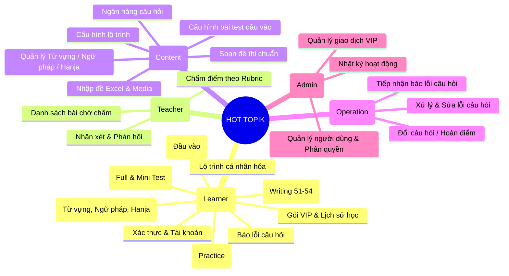

# 03 - DANH SÁCH MODULE VÀ CHỨC NĂNG (FUNCTIONAL MODULES)

> **Trạng thái**: Đã xác minh trong Controllers, Services và Templates của dự án.

---

## 1. Bản Đồ Tổng Quan Các Phân Hệ (Module Landscape)

Hệ thống HOT TOPIK được chia thành 14 phân hệ chức năng rõ ràng:

---

## 2. Chi Tiết Từng Module Chức Năng

### Module 1: Xác Thực & Tài Khoản (Auth & Profile)
- **Controller liên quan**: `AuthController.java`, `OnboardingController.java`, `LearnerController.java`.
- **Chức năng**:
  - Đăng ký tài khoản mới bằng Email, mật khẩu được mã hóa BCrypt.
  - Gửi mã OTP xác thực email thông qua Gmail SMTP (`EmailService.java`).
  - Đăng nhập hệ thống bằng Email/Mật khẩu hoặc Google OAuth2.
  - Quên mật khẩu & Đặt lại mật khẩu qua mã OTP xác minh qua Email.
  - Xem và cập nhật thông tin cá nhân: Họ tên, ảnh đại diện, số điện thoại, mục tiêu TOPIK, thời gian học mục tiêu hàng ngày (`dailyGoalMinutes`).
- **Actor**: Guest, Learner, Teacher, Content Manager, Operation Manager, Admin.
- **Trạng thái**: **ĐÃ HOÀN THÀNH**.

### Module 2: Đánh Giá Năng Lực Đầu Vào (Placement Test)
- **Controller liên quan**: `PlacementController.java`, `ContentPlacementController.java`.
- **Service liên quan**: `PlacementService.java`, `PlacementRules.java`.
- **Chức năng**:
  - Người học (kể cả Guest) làm bài kiểm tra nhanh 20 câu trắc nghiệm (10 Nghe + 10 Đọc, mỗi câu 10 điểm, tổng 200 điểm).
  - Hệ thống tự động chấm điểm tức thì, đưa ra đánh giá phân loại:
    - Dưới 80 điểm: Cấp 0 (Chưa đạt cấp 1).
    - 80 - 139 điểm: Cấp 1 (Sơ cấp 1).
    - Từ 140 điểm trở lên: Cấp 2 (Sơ cấp 2).
  - Đưa ra lời khuyên chọn lộ trình: Điểm cấp 0-1 khuyên học **TOPIK I**; Điểm cấp 2 khuyên học **TOPIK II**.
  - Cho phép người học tự chọn thời gian mục tiêu (31 - 200 ngày, mặc định 90 ngày) và lưu kết quả vào hồ sơ học tập.
  - Content Manager có cổng cấu hình đề Placement: chọn tỉ lệ câu hỏi theo từng dạng câu chuẩn.
- **Actor**: Guest, Learner, Content Manager.
- **Trạng thái**: **ĐÃ HOÀN THÀNH**.

### Module 3: Lộ Trình Học Tập Cá Nhân Hóa (Personalized Roadmap)
- **Controller liên quan**: `RoadmapController.java`, `ContentRoadmapController.java`.
- **Service liên quan**: `LearnerRoadmapService.java`, `ProgramRoadmapService.java`, `ProgramRules.java`.
- **Chức năng**:
  - Tự động sinh lịch học chi tiết từng ngày dựa trên kết quả Placement Test, mục tiêu (TOPIK 1 - 6) và số ngày mong muốn.
  - Phân bổ xen kẽ: Ngày học từ vựng/ngữ pháp mới, ngày luyện tập dạng câu hỏi, ngày ôn tập tuần (weekly review), và ngày thi thử.
  - Cơ chế **"Bắt nhịp lại" (Catch-up / Recovery)**: Khi người học nghỉ học liên tiếp từ 3 ngày trở lên, hệ thống tự động điều chỉnh lại lịch học để không bị dồn ứ kiến thức mà vẫn giữ vững mục tiêu thi cử.
  - Content Manager có thể tạo và phát hành các phiên bản chương trình lộ trình mẫu (`ProgramVersion`).
- **Actor**: Learner, Content Manager.
- **Trạng thái**: **ĐÃ HOÀN THÀNH**.

### Module 4: Luyện Tập Theo Dạng Câu Hỏi (Practice Engine)
- **Controller liên quan**: `PracticeController.java`.
- **Service liên quan**: `PracticeService.java`, `QuestionTypeCatalog.java`.
- **Chức năng**:
  - Luyện tập tập trung theo từng mã dạng câu hỏi cụ thể (ví dụ: `I-N1` Nghe chọn tranh, `I-D3` Đọc chọn câu cùng nội dung, `II-V1` Viết điền câu 51...).
  - Làm bài trên giao diện player tương tác: chọn đáp án, bấm "Kiểm tra" để xem đáp án đúng/sai ngay lập tức.
  - Hiển thị bản dịch phụ đề tiếng Hàn/tiếng Việt và giải thích cặn kẽ ngữ pháp cho từng phương án.
  - Hỗ trợ đánh dấu câu "Chưa chắc" và tính năng "Báo lỗi câu hỏi" trực tiếp trên từng câu.
  - Lưu lại lịch sử các lần luyện dạng với phân trang chuẩn (5 lần làm bài / trang).
- **Actor**: Learner.
- **Trạng thái**: **ĐÃ HOÀN THÀNH**.

### Module 5: Thi Thử Đề Chuẩn (Mock Exam Engine)
- **Controller liên quan**: `LearnerExamController.java`, `ContentExamController.java`.
- **Service liên quan**: `LearnerExamService.java`, `ExamComposerService.java`, `ExamScoreCalculator.java`.
- **Chức năng**:
  - Cung cấp hai loại đề thi:
    1. **Full Mock**: Đề thi hoàn chỉnh mô phỏng 100% thời gian thực (TOPIK I: 100 phút; TOPIK II: 180 phút chia 2 ca).
    2. **Mini Test**: Đề rút gọn theo từng kỹ năng đơn lẻ (Mini Nghe, Mini Đọc, Mini Viết).
  - Trình làm bài thi (`question-player.html` / `question-player.js`):
    - Đếm ngược thời gian, cảnh báo khi sắp hết giờ.
    - Lưu câu trả lời tự động (Autosave).
    - Hỗ trợ câu hỏi nhóm (Grouped Questions): Hiển thị đồng thời 2-3 câu hỏi chung một đoạn văn hoặc file audio.
    - **Cơ chế Sticky Neo đỉnh màn hình (`.qp-group-sticky`)**: Khi người học cuộn chuột làm các câu con bên dưới trong nhóm (từ 2 câu trở lên), đoạn văn, audio và ảnh đề bài dùng chung sẽ tự động ghim cố định ở đỉnh màn hình để người học không phải cuộn lên xuống. Đối với câu đơn bình thường, cơ chế ghim bị tắt hoàn toàn, hiển thị trong thẻ riêng lẻ như truyền thống.
    - **IntersectionObserver**: Đánh dấu chính xác số câu đang xem trên thanh điều hướng "Phiếu câu hỏi" bên phải.
  - Chấm điểm chuẩn TOPIK (`ExamScoreCalculator`) và xem lại kết quả:
    - Bảng điểm chi tiết từng kỹ năng theo thang điểm chuẩn (TOPIK I: 200đ; TOPIK II: 300đ) kèm xếp loại kết quả và điểm lịch sử thi.
    - Xem lại bài làm: Đáp án của bạn vs Đáp án đúng kèm giải thích.
    - **Lưu ý nghiệp vụ**: Riêng trang kết quả của đề thi kỹ năng Viết **không hiển thị bộ lọc Câu đúng / Câu sai** (do đặc thù câu tự luận).
- **Actor**: Learner, Content Manager (tạo và phát hành đề).
- **Trạng thái**: **ĐÃ HOÀN THÀNH**.

### Module 6: Phân Hệ Kỹ Năng Viết (Writing Module)
- **Controller liên quan**: `WritingController.java`, `TeacherPortalController.java`.
- **Service liên quan**: `Writing5152Evaluator.java`, `WritingSubmissionService.java`.
- **Chức năng**:
  - **Luyện viết câu 51 & 52 (Điền cụm từ)**:
    - Điền 2 vị trí `㉠` và `㉡`.
    - Hệ thống **tự động chấm điểm tức thì** dựa trên thuật toán phân tích cú pháp và quy tắc TOPIK II:
      - Câu 51: Bắt buộc kính ngữ trang trọng (`-습니다/-습니까`, `-시기 바랍니다`).
      - Câu 52: Bắt buộc văn viết (`-다/-ㄴ다/-는다`). Tuyệt đối cấm kính ngữ.
      - Chấm điểm độc lập từng ô: tối đa 5 điểm/ô (Nội dung 2.5đ + Ngôn ngữ 2.5đ).
  - **Luyện viết câu 53 (Giải thích biểu đồ 200-300 chữ) & Câu 54 (Nghị luận 600-700 chữ)**:
    - Bộ đếm số lượng ký tự trực tiếp trên giao diện viết chuẩn giấy thi TOPIK (giấy Wonkwanji).
    - Hướng dẫn dàn ý, mẫu câu ăn điểm và bài mẫu tham khảo.
  - **Gửi bài cho Giáo viên chấm**:
    - Đặc quyền dành riêng cho học viên VIP.
    - Phân tách rõ ràng giữa bài nộp từ phòng Luyện Viết (Practice) và bài làm trong lượt thi thử (Exam).
    - Lịch sử bài viết có phân trang (10 bài / trang).
- **Actor**: Learner (VIP), Teacher.
- **Trạng thái**: **ĐÃ HOÀN THÀNH**.

### Module 7: Kho Lý Thuyết Nền Tảng (Theory Vault)
- **Controller liên quan**: `TheoryController.java`, `ContentVocabularyController.java`, `ContentHanjaController.java`.
- **Service liên quan**: `VocabularyService.java`, `GrammarService.java`, `HanjaService.java`.
- **Chức năng**:
  - **Kho Từ Vựng TOPIK**: Phân loại theo cấp độ TOPIK 1 - 6, theo chủ đề (Topic), hỗ trợ tra nghĩa tiếng Việt, định nghĩa tiếng Hàn, phát âm audio và đánh dấu từ yêu thích.
  - **Kho Ngữ Pháp**: Phân loại theo nhóm ý nghĩa (Nguyên nhân, Mục đích, Giả định, Nhượng bộ...), giải thích chi tiết cấu trúc kết hợp, lưu ý quan trọng và các câu ví dụ mẫu thực tế.
  - **Kho Hán Tự Hanja**: Tra cứu gốc từ Hán (Hanja Roots) và các từ vựng phái sinh liên quan qua âm Hán Việt (Sino-Vietnamese) — công cụ độc quyền giúp người Việt nhớ từ vựng siêu nhanh.
- **Actor**: Learner, Content Manager.
- **Trạng thái**: **ĐÃ HOÀN THÀNH**.

### Module 8: Cổng Giảng Viên (Teacher Portal)
- **Controller liên quan**: `TeacherPortalController.java`.
- **Service liên quan**: `WritingSubmissionService.java`.
- **Chức năng**:
  - Bảng điều khiển danh sách các bài thi Viết đang chờ chấm từ học viên VIP.
  - Giao diện chấm bài chuyên dụng:
    - Xem đề bài, ảnh đề bài, đáp án mẫu và rubric chấm điểm.
    - Đọc bài viết của học viên.
    - Cho điểm chi tiết theo 3 tiêu chí TOPIK: Nội dung & hoàn thành nhiệm vụ, Cấu trúc bố cục, Sử dụng từ vựng & ngữ pháp.
    - Viết nhận xét chi tiết, chỉ ra các lỗi sai ngữ pháp/từ vựng trong bài của học viên.
  - Gửi kết quả chấm điểm kèm thông báo tự động đến tài khoản học viên.
- **Actor**: Teacher / Mentor.
- **Trạng thái**: **ĐÃ HOÀN THÀNH**.

### Module 9: Cổng Quản Lý Nội Dung (Content Portal)
- **Controller liên quan**: `ContentPortalController.java`, `ContentExamController.java`, `ContentPlacementController.java`, `ContentRoadmapController.java`.
- **Service liên quan**: `ExamImportService.java`, `ExamComposerService.java`, `QuestionBankService.java`, `MediaStorageService.java`.
- **Chức năng**:
  - Nhập đề thi tự động qua file Excel `.xlsx` mẫu chuẩn.
  - Nhập đề thủ công từng câu qua giao diện web:
    - Bắt buộc ánh xạ đúng và đủ ô số trên lưới (`num-grid`) cho từng câu hỏi con theo Question Type Catalog.
    - Hỗ trợ tải file nghe MP3 (kéo thả hoặc chọn file).
    - Hỗ trợ tải **ảnh đề bài cho mọi câu hỏi** (kỹ năng Nghe, Đọc, Viết) và đồng bộ ảnh hiển thị khi xem trước (`preview`).
    - Khung nhập 4 phương án trắc nghiệm: **hỗ trợ vừa nhập text vừa tải ảnh đồng thời cho từng phương án** (`opt1Img`..`opt4Img`).
  - Quản lý ngân hàng câu hỏi gốc: tìm kiếm, lọc theo dạng, kỹ năng, trạng thái.
  - Lập đề và xuất bản đề thi mới vào thư viện đề học viên.
- **Actor**: Content Manager.
- **Trạng thái**: **ĐÃ HOÀN THÀNH**.

### Module 10: Cổng Quản Lý Vận Hành & Xử Lý Báo Lỗi (Operation Portal)
- **Controller liên quan**: `OperationPortalController.java`, `QuestionReportController.java`, `QuestionCorrectionController.java`.
- **Service liên quan**: `QuestionReportService.java`, `QuestionCorrectionService.java`.
- **Chức năng**:
  - Tiếp nhận danh sách các báo cáo lỗi câu hỏi từ học viên (sai đáp án, lỗi âm thanh, lỗi chính tả, dịch sai).
  - Xem chi tiết phản ánh, so sánh câu hỏi gốc và nội dung học viên báo cáo.
  - Phối hợp sửa đổi câu hỏi: lưu lại lịch sử sửa đổi (Revision).
  - Phê duyệt sửa lỗi: Nếu câu hỏi bị sai đáp án dẫn đến học viên bị chấm sai, hệ thống cho phép kích hoạt quy trình cộng điểm bù tự động cho những học viên đã làm câu đó.
  - Gửi thông báo kết quả giải quyết phản ánh đến học viên.
- **Actor**: Operation Manager.
- **Trạng thái**: **ĐÃ HOÀN THÀNH**.

### Module 11: Cổng Quản Trị Hệ Thống (Admin Portal)
- **Controller liên quan**: `AdminController.java`.
- **Service liên quan**: `UserService.java`, `AdminSystemService.java`.
- **Chức năng**:
  - Quản lý người dùng: Tìm kiếm, lọc theo vai trò, kích hoạt, khóa tài khoản tạm thời hoặc vĩnh viễn với lý do rõ ràng.
  - Phân quyền tài khoản (gán vai trò: Học viên, Content Manager, Operation Manager, Teacher, Admin).
  - Quản trị gói hội viên VIP và phê duyệt gia hạn VIP.
  - Xem thống kê tổng quan hệ thống: Số lượng học viên, số lượt làm bài, số lượng đề thi, doanh thu gói VIP.
  - Giám sát nhật ký hoạt động hệ thống.
- **Actor**: Admin.
- **Trạng thái**: **ĐÃ HOÀN THÀNH**.

### Module 12: Gói Hội Viên VIP & Quà Tặng (VIP Membership)
- **Controller liên quan**: `VipController.java`.
- **Chức năng**:
  - Giới thiệu quyền lợi hội viên VIP: Không giới hạn thi thử, mở khóa toàn bộ đề thi thật, gửi bài viết câu 51-54 cho giáo viên chấm trực tiếp.
  - Đăng ký gói VIP (thời hạn 1 tháng, 3 tháng, 6 tháng hoặc trọn đời).
- **Actor**: Learner.
- **Trạng thái**: **ĐÃ HOÀN THÀNH**.

### Module 13: Đánh Giá & Phản Hồi (Feedback & Review)
- **Controller liên quan**: `FeedbackController.java`.
- **Service liên quan**: `ReviewService.java`.
- **Chức năng**: Học viên đánh giá sao và để lại cảm nhận về hệ thống hoặc các bài học; quản trị viên kiểm duyệt đánh giá trước khi hiển thị ra trang chủ.
- **Actor**: Learner, Admin.
- **Trạng thái**: **ĐÃ HOÀN THÀNH**.

### Module 14: Hệ Thống Thông Báo (User Notifications)
- **Service liên quan**: `NotificationService.java`.
- **Chức năng**: Tự động gửi thông báo trong ứng dụng (in-app notification) khi có sự kiện: giáo viên đã chấm xong bài viết, báo lỗi câu hỏi được xử lý, lịch học hôm nay cần hoàn thành, nâng cấp tài khoản VIP thành công.
- **Actor**: Toàn bộ người dùng.
- **Trạng thái**: **ĐÃ HOÀN THÀNH**.
