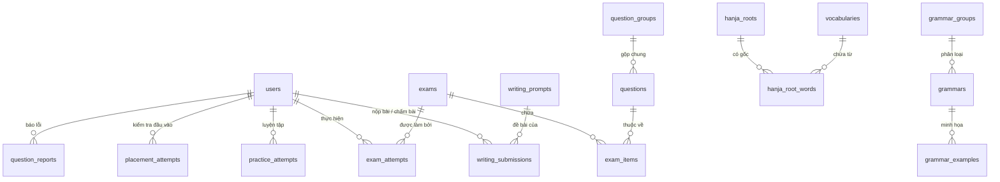

# 05 - THIẾT KẾ CƠ SỞ DỮ LIỆU (DATABASE DESIGN)

> **Trạng thái**: Đã xác minh từ toàn bộ các JPA Entity classes trong gói `com.hottopik.entity`.

---

## 1. Danh Mục Toàn Bộ Các Bảng Trong Cơ Sở Dữ Liệu

Cơ sở dữ liệu của HOT TOPIK gồm **34 bảng**, được nhóm thành 6 phân vùng dữ liệu chính:



---

## 2. Chi Tiết Các Bảng Theo Phân Vùng

### 2.1. Phân Vùng Người Dùng & Quản Trị Hệ Thống

| Tên Bảng (Table Name) | Entity Java | Khóa Chính (PK) | Mục Đích Lưu Trữ |
|:---|:---|:---|:---|
| `users` | `User.java` | `id (BIGINT)` | Tài khoản người dùng, email, mật khẩu băm, vai trò (role), trạng thái khóa, cấp độ TOPIK hiện tại, cấp độ mục tiêu, trạng thái VIP, thời hạn VIP, số ngày đã học (`studied_days`), số dư xu (`coin_balance`) |
| `auth_tokens` | `AuthToken.java` | `id (BIGINT)` | Token đặt lại mật khẩu, token xác thực email, thời hạn hết hạn (`expires_at`), ngày sử dụng (`used_at`) |
| `email_outbox` | `EmailOutbox.java` | `id (BIGINT)` | Hòm thư chờ gửi email bất đồng bộ, mẫu email (`template`), trạng thái gửi (`sent_at`), lỗi (`last_error`) |
| `user_settings` | `UserSetting.java` | `user_id (BIGINT)` | Cài đặt giờ nhắc nhở học tập hàng ngày (`reminder_time`) |
| `user_notifications` | `UserNotification.java` | `id (BIGINT)` | Thông báo gửi tới học viên: tiêu đề, nội dung, đường dẫn liên kết, trạng thái đã đọc |
| `reviews` | `Review.java` | `id (BIGINT)` | Đánh giá cảm nhận của người học về hệ thống (số sao 1-5, nội dung, trạng thái duyệt) |

### 2.2. Phân Vùng Kho Lý Thuyết (Từ Vựng, Ngữ Pháp, Hanja)

| Tên Bảng (Table Name) | Entity Java | Khóa Chính (PK) | Khóa Ngoại & Quan Hệ |
|:---|:---|:---|:---|
| `topics` | `Topic.java` | `id (BIGINT)` | Danh mục chủ đề từ vựng (Gia đình, Mua sắm, Du lịch, Công nghệ...) |
| `vocabularies` | `Vocabulary.java` | `id (BIGINT)` | Từ vựng tiếng Hàn: từ (`word`), phiên âm, loại từ (`pos`), nghĩa tiếng Việt, giải nghĩa tiếng Hàn, chữ Hán (`hanja`), âm Hán Việt (`sino_vi`), link phát âm (`audio_url`), cấp độ TOPIK (1-6) |
| `grammar_groups` | `GrammarGroup.java` | `id (BIGINT)` | Nhóm ý nghĩa ngữ pháp (Nguyên nhân, Mục đích, Nhượng bộ, Dự đoán...) |
| `grammars` | `Grammar.java` | `id (BIGINT)` | Mẫu cấu trúc ngữ pháp (`title`), công thức kết hợp (`pattern`), ý nghĩa tiếng Việt, giải thích chi tiết, cấp độ TOPIK (1-6). FK $\rightarrow$ `grammar_groups` |
| `grammar_examples` | `GrammarExample.java` | `id (BIGINT)` | Các câu ví dụ thực tế minh họa cho mẫu ngữ pháp. FK $\rightarrow$ `grammars` |
| `hanja_roots` | `HanjaRoot.java` | `id (BIGINT)` | Gốc từ Hán: chữ Hán đơn (`character`), âm Hán Việt (`sino_vi_reading`), nghĩa tiếng Việt, cấp độ |
| `hanja_root_words` | `HanjaRootWord.java` | Composite: `(root_id, vocab_id)` | Bảng liên kết N-N giữa Gốc chữ Hán (`hanja_roots`) và Từ vựng (`vocabularies`) |

### 2.3. Phân Vùng Đề Thi & Ngân Hàng Câu Hỏi (Exam & Questions)

| Tên Bảng (Table Name) | Entity Java | Khóa Chính (PK) | Các Trường Quan Trọng & Ý Nghĩa |
|:---|:---|:---|:---|
| `exam_sources` | `ExamSource.java` | `id (BIGINT)` | Nguồn đề nhập vào: tên nguồn, track (TOPIK I / II), năm thi, đợt thi, trạng thái nguồn (`SourceStatus`: DRAFT, ACTIVE) |
| `import_jobs` | `ImportJob.java` | `id (BIGINT)` | Tiến trình bóc tách đề: FK `source_id`, trạng thái (`ImportJobStatus`: DRAFT, PARSED, ACTIVATED), file Excel đính kèm, nhật ký cảnh báo |
| `media_assets` | `MediaAsset.java` | `id (BIGINT)` | Tệp âm thanh/hình ảnh dùng trong đề: FK `source_id`, tên file, loại (`MediaKind`: AUDIO, IMAGE), dung lượng byte |
| `question_groups` | `QuestionGroup.java` | `id (BIGINT)` | Nhóm ngữ cảnh dùng chung: mã nhóm, file audio dùng chung, đoạn văn dùng chung (`passage_ko`), phụ đề (`script_ko`), hình ảnh |
| `questions` | `Question.java` | `id (BIGINT)` | **Câu hỏi trắc nghiệm**: Đề bài (`prompt_ko`), 4 phương án (`opt1..opt4`), 4 ảnh phương án (`opt1_img..opt4_img`), đáp án đúng (`answer`: 1-4), giải thích tiếng Việt (`explanation_vi`), ảnh đề bài (`chart`), mã dạng (`type_code`), mục đích (`QuestionPurpose`: PRACTICE, EXAM, PLACEMENT), FK `group_id` |
| `writing_prompts` | `WritingPrompt.java` | `id (BIGINT)` | **Câu hỏi tự luận Viết**: Số câu (`no`: 51, 52, 53, 54), đề bài, ảnh đề bài (`chart`), đáp án chấp nhận câu 51-52 (`keys1`, `keys2`), bài văn mẫu (`model_answer`), tiêu chí chấm (`rubric`) |
| `exams` | `Exam.java` | `id (BIGINT)` | Đề thi đã xuất bản: mã đề, tên đề, track, loại đề (`ExamKind`: FULL, LISTENING, READING, WRITING), trạng thái (`ExamStatus`: DRAFT, PUBLISHED) |
| `exam_items` | `ExamItem.java` | `id (BIGINT)` | Bảng ghép nối câu hỏi vào đề thi: FK `exam_id`, kỹ năng (`Skill`), số thứ tự câu trên đề (`no`), FK `question_id` hoặc `writing_prompt_id` |
| `question_templates` | `QuestionTemplate.java` | `id (BIGINT)` | Khuôn dạng câu hỏi chuẩn của NIIED (mã khuôn, kỹ năng, số câu con tối thiểu/tối đa) |
| `question_types` | `QuestionTypeEntity.java` | `code (VARCHAR)` | Danh mục chi tiết các dạng câu hỏi chuẩn (`I-N1`..`I-D5`, `II-N1`..`II-V4`) |

### 2.4. Phân Vùng Lượt Thi & Chấm Bài (Attempts & Submissions)

| Tên Bảng (Table Name) | Entity Java | Khóa Chính (PK) | Các Trường Quan Trọng & Ý Nghĩa |
|:---|:---|:---|:---|
| `exam_attempts` | `ExamAttempt.java` | `id (BIGINT)` | Lượt làm bài thi: FK `user_id`, FK `exam_id`, số giây còn lại (`remaining_seconds`), ngày hoàn thành (`completed_at`), số câu đúng, tổng điểm, chuỗi JSON câu trả lời (`checked_answers_json`), chuỗi JSON điểm cộng bù (`credited_answers_json`) |
| `practice_attempts` | `PracticeAttempt.java` | `id (BIGINT)` | Lượt luyện tập theo dạng: FK `user_id`, mã dạng (`type_code`), số câu đúng/tổng câu, ngày làm |
| `writing_submissions` | `WritingSubmission.java` | `id (BIGINT)` | **Bài nộp kỹ năng Viết**: FK `user_id` (học viên), FK `prompt_id` (câu viết), FK `mentor_id` (giáo viên chấm), chế độ nộp (`PRACTICE` hoặc `EXAM`), trạng thái (`pending`, `reviewed`), **cột `payload` (JSON)** lưu chi tiết bài viết, điểm từng tiêu chí và lời nhận xét |

### 2.5. Phân Vùng Đánh Giá Đầu Vào & Lộ Trình (Placement & Roadmap)

| Tên Bảng (Table Name) | Entity Java | Khóa Chính (PK) | Các Trường Quan Trọng & Ý Nghĩa |
|:---|:---|:---|:---|
| `placement_attempts` | `PlacementAttempt.java` | `id (BIGINT)` | Lượt thi đầu vào: FK `user_id` (hoặc null nếu là khách), điểm số (0 - 200), cấp độ đề xuất (0, 1, 2), lộ trình đề xuất (TOPIK I / II) |
| `placement_lines` | `PlacementLine.java` | `id (BIGINT)` | Chi tiết từng câu trong bài test đầu vào: FK `attempt_id`, số thứ tự câu (1-20), đáp án người dùng chọn, kết quả đúng/sai |
| `study_plans` | `StudyPlan.java` | `id (BIGINT)` | Kế hoạch học tập cá nhân: FK `user_id`, ngày bắt đầu, ngày kết thúc mục tiêu, cấp độ mục tiêu |
| `program_versions` | `ProgramVersion.java` | `id (BIGINT)` | Phiên bản khung chương trình lộ trình học mẫu: mã phiên bản, track mục tiêu, tổng số ngày học |
| `program_version_items` | `ProgramVersionItem.java` | `id (BIGINT)` | Chi tiết bài học theo từng ngày: FK `version_id`, ngày thứ mấy (`day_no`), loại nhiệm vụ (Học từ vựng, Ngữ pháp, Luyện dạng, Thi thử), mã tài nguyên liên kết |

### 2.6. Phân Vùng Báo Lỗi & Xử Lý Sự Cố Câu Hỏi (Report & Revision)

| Tên Bảng (Table Name) | Entity Java | Khóa Chính (PK) | Các Trường Quan Trọng & Ý Nghĩa |
|:---|:---|:---|:---|
| `question_reports` | `QuestionReport.java` | `id (BIGINT)` | Phản ánh từ học viên: FK `user_id`, FK `question_id`, loại lỗi (sai đáp án, lỗi âm thanh, dịch sai...), nội dung phản ánh, trạng thái xử lý (`PENDING`, `RESOLVED`, `REJECTED`) |
| `question_revisions` | `QuestionRevision.java` | `id (BIGINT)` | Lịch sử sửa đổi câu hỏi: FK `question_id`, nội dung trước và sau khi sửa, người sửa, lý do sửa |
| `question_revision_recipients` | `QuestionRevisionRecipient.java` | `id (BIGINT)` | Danh sách học viên được hoàn điểm / cộng điểm bù do câu hỏi sửa đổi: FK `revision_id`, FK `user_id`, FK `attempt_id`, số điểm được cộng bù |

---

## 3. Cấu Trúc Các Trường Dữ Liệu Dạng JSON (JSON Columns)

Hệ thống tận dụng định dạng JSON lưu trữ linh hoạt trong SQL Server / H2 cho các đối tượng có cấu trúc biến đổi:

1. **`writing_submissions.payload`**:
   ```json
   {
     "answer": "Nội dung bài viết tiếng Hàn của học viên...",
     "charCount": 245,
     "scores": {
       "taskContent": 2.5,
       "structure": 2.0,
       "language": 2.5
     },
     "totalScore": 7.0,
     "feedback": "Học viên nắm tốt cấu trúc biểu đồ câu 53, cần chú ý chia đuôi câu khách quan hơn...",
     "attemptId": 142,
     "examTitle": "TOPIK II 36 - Mini Viết"
   }
   ```
2. **`exam_attempts.checked_answers_json`**:
   - Lưu trữ danh sách các câu đã làm và đáp án học viên chọn dưới dạng Map key-value: `{"answer_101": "2", "answer_102": "4", "writing_51": "..."}`.
3. **`exam_attempts.credited_answers_json`**:
   - Lưu trữ lịch sử cộng điểm bồi hoàn khi câu hỏi có sự điều chỉnh đáp án từ ban quản trị: `{"101": {"oldAnswer": "2", "newAnswer": "3", "creditedPoints": 2.5}}`.

---

## 4. Danh Sách Các Enum Hệ Thống (Core Enums)

- `Track`: `TOPIK_I` (Sơ cấp), `TOPIK_II` (Trung - Cao cấp).
- `Skill`: `LISTENING` (Nghe), `READING` (Đọc), `WRITING` (Viết).
- `ExamKind`: `FULL` (Đề trọn bộ), `LISTENING` (Mini Nghe), `READING` (Mini Đọc), `WRITING` (Mini Viết).
- `ExamStatus`: `DRAFT` (Bản nháp), `PUBLISHED` (Đã xuất bản), `ARCHIVED` (Lưu trữ).
- `ImportJobStatus`: `DRAFT` (Khởi tạo), `PARSED` (Đã đọc file), `VALIDATED` (Đã kiểm tra logic), `ACTIVATED` (Đã chuyển thành đề), `FAILED` (Thất bại).
- `MediaKind`: `AUDIO` (Âm thanh MP3), `IMAGE` (Hình ảnh).
- `QuestionPurpose`: `PRACTICE` (Dành cho Luyện tập), `EXAM` (Dành cho Đề thi), `PLACEMENT` (Dành cho Test đầu vào).
- `QuestionStatus`: `DRAFT` (Nháp), `ACTIVE` (Đang hoạt động), `ARCHIVED` (Lưu trữ).
- `TemplateStatus`: `ACTIVE`, `INACTIVE`.
- `ProgramStatus`: `DRAFT`, `PUBLISHED`, `ARCHIVED`.
