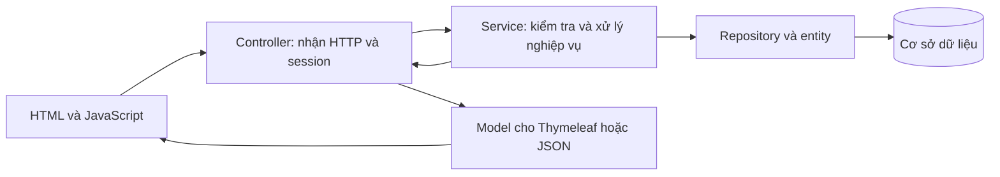
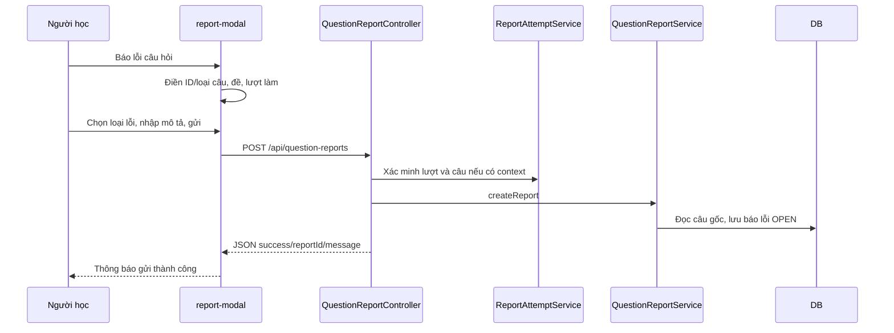
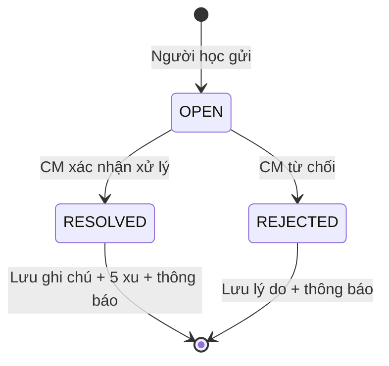

# Giải thích luồng Luyện tập, Đề thi, Hán Việt và Báo lỗi

Tài liệu mô tả **code hiện có**, bao gồm các phần dùng dữ liệu thật và các phần còn mô phỏng. Comment tiếng Việt đã được đặt tại các điểm vào, thuật toán và đoạn render chính. Lượt bổ sung tài liệu này không thay đổi nghiệp vụ.

## 1. Cách đọc code của các luồng

- **Controller**: nhận URL, tham số, tài khoản từ session; gọi service; trả trang hoặc JSON. `return "practice/play"` chọn template, còn `redirect:` yêu cầu trình duyệt sang URL khác.
- **Service**: chọn câu, kiểm tra quyền và dữ liệu, tính điểm, đổi trạng thái, tạo thông báo. Các kiểm tra trên trình duyệt không thay cho kiểm tra ở đây.
- **Repository**: thực hiện truy vấn; nhiều tên như `findByUserId...` được Spring Data JPA chuyển thành truy vấn.
- **Entity**: ánh xạ bảng. Trong transaction, JPA có thể tự lưu thay đổi entity đã được quản lý khi transaction kết thúc, dù không gọi `save()` ngay tại mỗi dòng `set...`.
- **DTO/record**: đóng gói dữ liệu chuyển lên giao diện. `QuestionPlayerItem` chuẩn hóa form của ba nguồn dữ liệu, không chọn câu hoặc tính điểm.
- **Thymeleaf**: `th:each` lặp danh sách; `th:if` quyết định render; `th:text` đưa nội dung vào HTML; `th:action` tạo URL nộp form. JavaScript tiếp tục xử lý chuyển câu, gọi API và cập nhật DOM.

## 2. Luyện tập theo dạng

### 2.1. Vào trang, chọn kỹ năng và cấp độ

**Luồng:** `GET /practice` hoặc `/luyen-tap` → `PracticeController.practiceIndex()` → `PracticeService.allSummaries()` → `practice/index.html` và `practice/fragments.html`.

1. Controller lấy người dùng từ `AuthHelper.getLoggedInUser(session)`.
2. Service duyệt `QuestionTypeCatalog.all()`. Danh mục dạng tồn tại độc lập với câu hỏi trong kho, nên không có đề vẫn có dạng để hiển thị.
3. Với Nghe/Đọc, service lấy các câu khả dụng, lịch sử đã nộp của người học, phần trăm tốt nhất và gần nhất. Với Viết, dữ liệu đến từ `WritingPrompt` và `WritingSubmissionService`.
4. Controller chia dữ liệu thành `listeningI`, `listeningII`, `readingI`, `readingII`, `writingII` rồi đưa vào model.
5. JavaScript `setLevel()` đổi section hiển thị. Đổi tab kỹ năng mặc định chọn TOPIK I; TOPIK I Viết hiện thông báo không có phần Viết.
6. Nếu URL có `skill` và `track`, `initialSkill`/`initialTrack` áp lại đúng ngữ cảnh sau khi tab mở. Các liên kết “Chọn dạng khác” mang ngữ cảnh này để quay lại đúng kỹ năng/cấp độ.

**Đoạn code:** [PracticeController](../src/main/java/com/hottopik/controller/PracticeController.java), các method `practiceIndex`, `preparePractice`; [PracticeService](../src/main/java/com/hottopik/service/PracticeService.java), `allSummaries`; [giao diện chọn dạng](../src/main/resources/templates/practice/index.html), `setLevel` và khối `initialSkill`.

### 2.2. Chuẩn bị và kiểm tra có đủ câu

`GET /practice/prepare?typeCode=...` tra cấu hình dạng theo mã, lấy `summary` và `history`, rồi render [prepare.html](../src/main/resources/templates/practice/prepare.html).

- `summary.available == 0`: hiện thông báo chưa có bài, không hiện form bắt đầu.
- `summary.available > 0`: cho gửi `POST /practice/start`. Có một vài câu chưa đồng nghĩa đã có đủ bộ câu hợp lệ; service kiểm tra đầy đủ ở bước bắt đầu.
- Lịch sử tại trang này chỉ lấy lượt có `completedAt`, sắp mới nhất trước. “Chi tiết” mở kết quả lượt đó; “Làm lại” tạo lượt mới từ đúng bộ câu đó.
- Nếu bắt đầu từ lộ trình, form mang thêm `day` và `slot`. Controller kiểm tra buổi có thật sự khớp dạng trong lộ trình trước khi tạo lượt.

### 2.3. Chọn câu và tạo lượt mới

`POST /practice/start` → `PracticeController.startPractice()` → `PracticeService.start()`.

**Bộ lọc dữ liệu:** `pool()` gọi `QuestionRepository.findPracticeCandidates(track, skill, numbers)`:

- Đúng cấp độ, kỹ năng và vị trí số câu mà catalog quy định.
- Câu `ACTIVE` và nguồn `ACTIVE`.
- Nguồn không phải đánh giá đầu vào, mục đích câu không phải `ASSESSMENT`.

Việc tra theo số câu chuẩn tránh bỏ sót dữ liệu khi Content Manager dùng cùng khuôn nhập tay cho nhiều vị trí và `typeCode` trên câu chưa phản ánh đúng vị trí thực tế.

**Thuật toán chọn bộ:**

1. Lấy `questionIds` của những lượt **đã nộp** cùng người học và dạng để lập tập `seen`.
2. `QuestionTypeDef.blocks()` mô tả từng cụm câu dùng chung ngữ liệu. `requiredCount()` là tổng số vị trí trong các cụm.
3. Với mỗi block, tìm nhóm đủ các số câu của block; giữ nguyên quan hệ ngữ liệu trong nhóm.
4. Riêng Đọc: nếu mỗi câu được nhập thành card một câu, có thể ghép các card đủ vị trí **trong cùng nguồn**, không ghép tùy ý giữa các đề.
5. Ưu tiên nhóm mà mọi câu đều chưa xuất hiện trong `seen`. Nếu không còn nhóm mới, dùng lại nhóm đã gặp; trộn rồi chọn một nhóm cho block.
6. Sắp theo số câu, kiểm tra tổng bằng `requiredCount()`. Thiếu bộ đầy đủ thì báo lỗi, không tạo attempt.
7. Lưu `PracticeAttempt`: chủ lượt, kỹ năng/cấp độ/dạng, danh sách ID đã chọn, tổng câu, đáp án rỗng và điểm 0.

**Điểm cần hiểu:** “Ngẫu nhiên” không bảo đảm tất cả câu luôn khác lần trước. Khi kho ít hoặc đã dùng hết các nhóm mới, code sẽ dùng lại. Các lượt chưa nộp chưa được tính vào tập đã gặp.

**Đoạn code:** [PracticeService](../src/main/java/com/hottopik/service/PracticeService.java), `start`, `pool`; [QuestionRepository](../src/main/java/com/hottopik/repository/exam/QuestionRepository.java), `findPracticeCandidates`; [QuestionTypeDef](../src/main/java/com/hottopik/service/exam/QuestionTypeDef.java), `blocks`, `requiredCount`, `numbers`.

### 2.4. Hiển thị và thao tác câu hỏi

`GET /practice/play/{attemptId}` nạp lượt của người học; đã nộp thì chuyển sang kết quả. Các câu được đọc đúng thứ tự ID đã lưu, chuyển qua `QuestionPlayerItem.practice()` và đưa vào form chung.

| Thao tác | Code xử lý | Tác động |
| --- | --- | --- |
| Câu trước/tiếp, bấm số câu | `question-player.js`: `show()` | Đổi câu đang hiện, dừng audio câu rời đi; các input vẫn nằm trong form. Câu đầu không dùng được Câu trước. |
| Chọn đáp án | Radio `answer_<questionId>`, listener `change`, `update()` | Tô lựa chọn, đổi trạng thái ma trận, hiện Kiểm tra; xóa phản hồi cũ nếu đổi đáp án. |
| Chưa chắc | Set `flagged`, `update()`, `persist()` | Bật/tắt đánh dấu; có thể đánh dấu câu đã chọn hoặc chưa chọn đáp án. |
| Khôi phục cục bộ | `sessionStorage` theo URL/action lượt làm | Lưu câu đang xem, đánh dấu và lựa chọn luyện dạng; chưa phải lưu nháp vào DB. |
| Ảnh/âm thanh | Template và DTO | Câu/đáp án có ảnh dùng bố cục ảnh; audio hiện cho Nghe có file. |
| Báo lỗi | `openReportModalFromBtn()` | Mở form chung kèm ID câu và lượt làm; xem mục 5. |

**File:** [fragment form câu hỏi](../src/main/resources/templates/fragments/question-player.html), [JavaScript form](../src/main/resources/static/js/question-player.js), [CSS](../src/main/resources/static/css/question-player.css), [QuestionPlayerItem](../src/main/java/com/hottopik/dto/QuestionPlayerItem.java), [practice/play.html](../src/main/resources/templates/practice/play.html).

### 2.5. Kiểm tra một đáp án

`Kiểm tra` → JavaScript POST `selected` đến `/practice/check/{attemptId}/{questionId}` → controller → `PracticeService.check()`.

1. Bắt buộc có tài khoản trong session; xác minh lượt thuộc tài khoản đó.
2. Xác minh câu nằm trong `questionIds` của lượt và lựa chọn trong 1..4.
3. Lấy đáp án và giải thích từ ngân hàng; với Nghe lấy thêm `scriptKo`.
4. Trả `QuestionFeedback`: đáp án đúng, đúng/sai, giải thích, phụ đề và trường bản dịch.
5. JavaScript tô đáp án đúng, đánh dấu lựa chọn sai, mở giải thích; Nghe có thêm phụ đề/bản dịch. Nếu người học đổi lựa chọn lúc request đang chạy, phản hồi cũ bị bỏ.

Kiểm tra **không nộp bài, không cộng điểm và không lưu lựa chọn**. Dữ liệu hiện chưa có bản dịch phụ đề nên `scriptTranslation` trả `null`; giao diện thông báo thiếu, không tự tạo bản dịch.

### 2.6. Nộp, kết quả, lịch sử, làm lại

1. `confirmSubmit()` tính số đã trả lời, chưa làm và đánh dấu chưa chắc để mở modal. “Chưa chắc” có thể giao với hai trạng thái còn lại, nên ba số không cộng thành tổng câu.
2. **Làm tiếp** đóng modal và ở lại bài. **Nộp bài** gọi lại submit thật qua `requestSubmit()`.
3. Controller chỉ đọc field `answer_...`; service duyệt các ID **đã lưu trong lượt**, chỉ nhận lựa chọn 1..4 và chấm theo đáp án trong ngân hàng. Không tin điểm client gửi.
4. Lưu `answersJson`, số câu đúng trong `score`, và `completedAt`. Lượt đã nộp nhận yêu cầu nộp lại sẽ trả lượt cũ, không chấm lại.
5. Nếu có liên kết buổi lộ trình còn khớp, controller đánh dấu buổi hoàn thành. Nếu lộ trình đổi, bài vẫn được lưu và có cảnh báo riêng.
6. `result()` ghép câu gốc với lựa chọn để tạo `AnswerView`, tính thời lượng và lấy lịch sử cùng dạng. [result.html](../src/main/resources/templates/practice/result.html) render các tab chi tiết/lịch sử.
7. `GET /practice/retry/{id}` sao chép danh sách câu sang attempt mới, đáp án/điểm rỗng. `GET /practice/next?typeCode=...` chạy lại thuật toán chọn câu mới.

Nội dung và lời giải khi xem kết quả đang được đọc từ **ngân hàng hiện tại**, chưa phải bản chụp bất biến của nội dung tại thời điểm nộp.

### 2.7. Nhánh Viết của Luyện tập

Viết không chạy thuật toán MC ở trên. Khi dạng có đề hoạt động, `startPractice()` chuyển sang `/writing?question=51..54`.

- [WritingController](../src/main/java/com/hottopik/controller/WritingController.java), `writing()`: lấy `WritingPrompt ACTIVE` đúng số câu; ưu tiên `promptId` hợp lệ, sau đó random nếu được yêu cầu, hoặc lấy đề mới nhất. Không có đề thì `currentPrompt == null`.
- [writing/index.html](../src/main/resources/templates/writing/index.html): hiện cảnh báo khi không có đề; có đề thì mở phần nhập bài riêng. Nội dung đề/bài mẫu/ghi chú được đưa từ `currentPrompt` vào giao diện.
- `submitToTeacherModal()` ghép đáp án hai ô cho 51/52 hoặc bài dài cho 53/54; form POST `/writing/submit-mentor`.
- `submitToMentor()` tạo bài thông qua [WritingSubmissionService](../src/main/java/com/hottopik/service/WritingSubmissionService.java), `submitNewEssay()`, trạng thái `waiting`, rồi chuyển `/writing/feedback?id=...`.
- Service có các bước `claimSubmission` → `claimed`, `gradeSubmission` → `graded`; người học có thể gửi câu hỏi (`askQuestion`), đánh giá 1..5 (`rateSubmission`) và khiếu nại (`appealSubmission` → `appeal`).

**Phần hiện còn mô phỏng:** bài gửi giáo viên đang lưu trong `ConcurrentHashMap` của tiến trình, không phải DB; `aiScore` được gán giá trị cố định theo số câu. `runInstantAiGrading()` chỉ hiện toast/cuộn thẻ kết quả, chưa gọi dịch vụ AI và chưa thực sự cộng xu. Câu 53 khi gửi giáo viên còn dùng dữ liệu biểu đồ cố định. Không nên hiểu thông báo giao diện là đã có chấm AI thật hoặc cam kết xử lý 48 giờ bằng hệ thống tự động.

## 3. Đề thi của người học

### 3.1. Thư viện đề và trạng thái

`GET /exam` hoặc `/de-thi` → [LearnerExamController.library](../src/main/java/com/hottopik/controller/LearnerExamController.java) → [LearnerExamService.library](../src/main/java/com/hottopik/service/exam/LearnerExamService.java) → [exam/index.html](../src/main/resources/templates/exam/index.html).

Service tạo cấu trúc `I/II → full/listening/reading/writing → Card`. Chỉ đưa đề được phép phát hành và có nội dung sử dụng được vào thư viện. `usable()` kiểm tra nguồn/câu còn hoạt động, loại câu đánh giá đầu vào; mini phải có cấu trúc gọn hợp lệ.

Lịch sử được nhóm theo **`exam.id`**, không theo nguồn hoặc ID full mock cha. Vì vậy full mock và mini sinh từ full mock có cùng nội dung gốc vẫn có các lượt/trạng thái độc lập.

| Trạng thái | Điều kiện | Hành động |
| --- | --- | --- |
| Đang làm dở | Có lượt chưa nộp, còn thời gian và chưa quá 7 ngày | Làm tiếp; nếu từng có kết quả thì thêm Xem kết quả. |
| Đã làm | Có lượt đã nộp và không có lượt dở hợp lệ | Xem kết quả, Làm lại. |
| Chưa làm | Không có hai loại lượt trên | Bắt đầu. |

`renderExams()` chỉ dựng thẻ/nút theo Card do server tính. Ngăn không có đề hiện thông báo chưa có đề được phát hành. Ngăn Viết không mở ở TOPIK I. Trang Đề thi hiện mặc định TOPIK II khi URL không chỉ định `track=I`; đây là quy tắc riêng, khác trang Luyện tập.

### 3.2. Bắt đầu và làm tiếp

- POST `/exam/{id}/start`: yêu cầu đăng nhập; khóa đề, kiểm tra trạng thái và dữ liệu. Có lượt còn tiếp tục được của chính người học và **đúng examId** thì dùng lại.
- POST `/exam/{id}/retry`: tạo lượt mới dù đã có lượt dở. Bộ câu lấy từ cấu trúc đề hiện tại, không random lại kho như luyện dạng.
- `ExamAttempt` mới lưu `exam`, `userId`, giây còn lại và mốc hoạt động. `total` là số câu MC; phần Viết không bị tính như câu trắc nghiệm.
- GET `/lam-bai/{attemptId}`: `play()` xác minh chủ lượt, chốt thời gian server; lượt hết hạn/hết giờ được hoàn tất, còn hợp lệ tiếp tục tính giờ.

### 3.3. Form, autosave và thời gian

`paper(attempt, false)` dựng dữ liệu làm bài, phục hồi lựa chọn, **không nhúng đáp án/giải thích/lời thoại**. Adapter đưa MC sang form chung; Viết giữ textarea và bố cục riêng trong [exam/play.html](../src/main/resources/templates/exam/play.html).

| Field | Ý nghĩa |
| --- | --- |
| `q<ExamItem.id>` | Lựa chọn MC ở vị trí câu của đề này. Khác ID câu ngân hàng. |
| `w<WritingPrompt.id>` | Nội dung trả lời phần Viết. |
| `answersJson` | Map các key trên đã được server kiểm tra và lưu trong ExamAttempt. |

`saveAnswers()` gửi toàn form khi đổi lựa chọn, debounce 1 giây khi gõ và định kỳ 15 giây. Promise nối các yêu cầu; khi nộp/dừng sẽ chờ request đang lưu xong. Server chỉ nhận key thuộc đề, MC 1..4, bài Viết tối đa 6000 ký tự.

`remaining()` tính giây còn lại từ thời gian **server**, `checkpoint()` lưu lại giây và xóa mốc tính cũ. Trình duyệt chỉ hiển thị đồng hồ; sửa đồng hồ giao diện không kéo dài thời gian trên server.

- **Lưu và thoát**: POST `/exam/attempt/{id}/pause`, lưu đáp án và ngừng tính thời gian hoạt động, quay đúng cấp độ/loại đề.
- **Rời trang**: `pagehide` gửi beacon với `pause=true` để cố gắng lưu/dừng; thành công vẫn phụ thuộc trình duyệt/mạng.
- **Hết giờ**: `tick()` gắn `timedOut` rồi nộp, bỏ modal xác nhận. Nếu request tới server khi lượt đã hết hạn, server hoàn tất với đáp án đã lưu thay vì nhận cập nhật đến muộn.

Các thao tác ghi trên một attempt dùng `findOwnedForUpdate(id, userId)` với khóa `PESSIMISTIC_WRITE`, giúp tuần tự hóa các request cùng lượt và kiểm tra quyền sở hữu.

### 3.4. Kiểm tra, nộp và xem kết quả

Nút Kiểm tra gọi POST `/exam/attempt/{id}/check/{key}`. Service kiểm tra chủ lượt, key thuộc đề và lựa chọn, trả phản hồi câu đó. Không sửa `answersJson`, điểm hay đồng hồ trong endpoint này.

Nộp thủ công dùng modal tóm tắt chung cho form có MC. Bài chỉ có Viết giữ xác nhận hiện tại của form Viết. `/submit` gọi `save(..., submit=true)` rồi `finish()`:

1. Lưu các câu trả lời hợp lệ nếu lượt còn hạn.
2. Đếm MC đúng từ đáp án ngân hàng, ghi `completedAt`, dừng giờ. Không tự tạo điểm luận văn.
3. Chuyển `/ket-qua/{attemptId}`.
4. `paper(attempt, true)` bổ sung đáp án/giải thích/phụ đề/bài mẫu và lịch sử **cùng người học, cùng đề**, chỉ lấy lượt đã nộp.
5. [exam/result.html](../src/main/resources/templates/exam/result.html) hiển thị lựa chọn, lời giải và lịch sử; câu Viết giữ bài đã nhập, dữ liệu tham khảo và thông báo không tự tính điểm tự luận.

Luồng đề thi dùng `ExamAttempt`, khác `WritingSubmissionService` gửi giáo viên và khác `PracticeAttempt` luyện dạng.

## 4. Lý thuyết Cầu nối Hán Việt

### 4.1. Trang và dữ liệu

GET `/ly-thuyet/han-viet` hoặc `/theory/hanja` → [TheoryController.hanja](../src/main/java/com/hottopik/controller/TheoryController.java) → [HanjaServiceImpl](../src/main/java/com/hottopik/service/HanjaServiceImpl.java) → [theory/hanja.html](../src/main/resources/templates/theory/hanja.html).

Quan hệ dữ liệu: **HanjaRoot → HanjaRootWord → Vocabulary**. Gốc giữ chữ Hán, âm Hàn, âm Hán Việt, nghĩa, audio; bảng nối chỉ ra từ vựng liên quan và chữ Hán ghép; Vocabulary chứa từ Hàn, nghĩa Việt, âm Hán Việt và audio của từ.

1. `getActiveHanjaRoots()` tìm gốc `ACTIVE`; `convertToDTO()` ghép danh sách từ liên quan.
2. Controller nhúng `hanjaRoots` và `hanjaStats` qua Thymeleaf thành `serverRoots`/`serverStats`. Nếu có lỗi, trả cấu trúc rỗng.
3. Khi DOM sẵn sàng, JavaScript ưu tiên `serverRoots`; thiếu thì `loadRootsFromApi()` gọi `/api/learner/hanja/roots`.
4. `renderGrid()` vẽ lưới; `selectRoot()` lấy dữ liệu đã có trong mảng, cập nhật chữ lớn/âm đọc/nghĩa/bảng từ mà không cần request chi tiết mới.
5. `filterHanja()` lọc mảng cục bộ theo chữ Hán, âm Hán Việt, âm Hàn hoặc nghĩa. API roots cũng hỗ trợ `query` nếu cần tải bằng server.

[LearnerHanjaController](../src/main/java/com/hottopik/controller/LearnerHanjaController.java) chỉ phục vụ JSON: `/roots`, `/roots/{id}`, `/quiz`, `/stats`. Trang HTML do TheoryController phục vụ; chú thích tiếng Anh cũ ở đầu LearnerHanjaController không phải mapping thực tế của trang.

### 4.2. Đã học và âm thanh

`markLearned()` bật/tắt ID gốc trong Set, ghi `localStorage['hanjaLearned']`, cập nhật nút, dấu tick và bộ đếm. Chưa có API lưu tiến độ này theo tài khoản; cùng hồ sơ trình duyệt dùng chung khóa, thiết bị khác không tự đồng bộ.

`speakKorean()` ưu tiên phát `audioUrl`. Nếu không có hoặc phát lỗi thì `fallbackSpeak()` đọc bằng Speech Synthesis `ko-KR` nếu trình duyệt hỗ trợ.

### 4.3. Đoán nghĩa từ mới

1. `startNewQuiz(count)` reset trạng thái, gọi `/api/learner/hanja/quiz?count=...`.
2. Controller giới hạn yêu cầu vào 5..30; service lấy các gốc ACTIVE và từ ACTIVE có từ/nghĩa để tạo ứng viên.
3. Trộn ứng viên, lấy tối đa số yêu cầu; với mỗi câu lấy nghĩa đúng, thêm tối đa ba nghĩa nhiễu từ kho, thiếu thì bù `—`.
4. Trộn bốn lựa chọn, trả `correctChoiceIndex` **0..3** cùng nội dung. Đây khác lựa chọn MC TOPIK **1..4**.
5. `showQuestion()` vẽ câu và bốn nút. `answerQuiz()` chỉ nhận một lần chọn, so index, tô đúng/sai, khóa nút và tăng `quizScore`.
6. `nextQuestion()` tăng vị trí; hết bộ gọi `showQuizResult()` tính phần trăm và thông điệp.

Quiz hiện chấm tại trình duyệt bằng đáp án API trả, chưa lưu điểm/lịch sử vào DB. Lấy quiz rỗng thì trang báo chưa có dữ liệu; lỗi request hiện thông báo thử lại.

**Đặc điểm dữ liệu hiện tại:** `convertToDTO()` không lọc trạng thái Vocabulary trong danh sách từ liên quan, còn quiz có lọc ACTIVE; một từ liên kết nhiều gốc có thể xuất hiện nhiều lần trong ứng viên quiz. Phần chọn nghĩa nhiễu chưa `distinct` nên không bảo đảm ba nghĩa đều khác nhau. `/stats` trả tổng kho và số gốc hoạt động, không phải tiến độ cá nhân.

## 5. Người học báo lỗi câu hỏi

### 5.1. Nút và modal

[fragments/report-modal.html](../src/main/resources/templates/fragments/report-modal.html), `openReportModalFromBtn()` đọc `data-qid`, `data-kind`, mã, số câu, đề và nội dung hiển thị. Nó tìm ancestor có `data-report-attempt-id` để lấy `attemptId`/`attemptKind`.

`submitQuestionReport()` chặn submit chuyển trang, kiểm tra mô tả tối thiểu, khóa nút tránh bấm lặp khi request đang chạy rồi gửi `FormData`. Thành công hiện thông báo/đóng modal; thất bại hiện lỗi và mở lại nút. Bước gửi thành công chỉ có nghĩa đã ghi nhận yêu cầu, chưa thưởng xu.

### 5.2. Kiểm tra và lưu server

- `QuestionReportController.submitReport()` lấy người gửi thật từ session; khách nhận 401. Mô tả phải 3..2000 ký tự.
- `ReportAttemptService.validate()` không bắt buộc context với form cũ; nếu có context phải đầy đủ, đúng chủ lượt và câu thuộc lượt. EXAM còn xác minh đề nếu form có `examId`.
- `QuestionReportService.createReport()` dùng `questionKind=MC/WRITING` để phân biệt bảng Question và WritingPrompt. Hai bảng có thể có cùng ID số nên không được tìm chỉ dựa ID.
- Có ID câu, service lấy lại mã/nội dung/số câu từ DB; có ID đề thì xác minh câu thuộc đề và lấy tên chuẩn. Không tin nội dung câu client tự gửi thay cho ngân hàng.
- Lưu vào `question_reports`: người gửi, câu/loại câu, đề nếu có, ngữ cảnh lượt, loại lỗi, mô tả, trạng thái `OPEN`, thưởng dự kiến 5.
- Trường hợp demo cũ không có ID ngân hàng chỉ lưu summary và không liên kết tùy ý một câu khác.

**Đoạn code:** [QuestionReportController](../src/main/java/com/hottopik/controller/QuestionReportController.java), `submitReport`; [QuestionReportService](../src/main/java/com/hottopik/service/QuestionReportService.java), `createReport`; [ReportAttemptService](../src/main/java/com/hottopik/service/ReportAttemptService.java), `validate`; [QuestionReport](../src/main/java/com/hottopik/entity/QuestionReport.java).

## 6. Content Manager xem và xử lý báo lỗi

### 6.1. Danh sách và xem câu liên quan

`GET /content?tab=reports` → `ContentPortalController.dashboard()` lấy `getAllReports()` và `getPendingCount()` → [content/dashboard.html](../src/main/resources/templates/content/dashboard.html). JavaScript đọc `tab=reports` để mở đúng tác vụ; bảng nhận dữ liệu từ model.

`viewReportQuestion()` mở modal và fetch `/content/reports/{reportId}/question`. Controller kiểm tra quyền, gọi `reportedQuestion()` và trả [report/question.html](../src/main/resources/templates/report/question.html) dưới dạng fragment HTML.

`reportedQuestion()` ghép nội dung hiện tại từ đúng Question/WritingPrompt với đoạn văn, audio, hình, bốn phương án, lời giải hoặc bài mẫu/biểu đồ. Báo lỗi legacy phải khớp nội dung để tránh ID trùng; không xác định được thì template hiện summary đã báo. Media chỉ được trả khi người xem có quyền và filename thực sự liên kết với câu đó.

Đổi báo lỗi khi request cũ còn chạy không làm modal bị ghi đè bằng câu trước, nhờ kiểm tra `dataset.reportId` trước khi nhúng kết quả.

### 6.2. Sửa câu trắc nghiệm rồi xử lý

1. GET `/content/reports/{id}/edit` kiểm tra vai trò và báo lỗi còn OPEN/còn câu gốc.
2. MC chuyển `/content/questions?openQuestionId=<questionId>&reportId=<reportId>`.
3. [content/exam/questions.html](../src/main/resources/templates/content/exam/questions.html) tự mở đúng form bằng `openQuestionId`, tải chi tiết `/content/questions/{id}/detail`; chỉ gắn reportId vào form khi đúng câu đang mở.
4. POST `/content/questions/{id}` → [ContentExamController.updateQuestion](../src/main/java/com/hottopik/controller/ContentExamController.java): xác minh báo lỗi OPEN, đúng câu và loại MC.
5. `QuestionBankService.update()` yêu cầu CM, câu không trống, đủ bốn phương án không trùng và đáp án 1..4; đổi đáp án phải có lý do ít nhất 5 ký tự. Cập nhật lời giải, content hash và audit.
6. Controller gọi `resolveReport()` với ghi chú gửi người học rồi quay lại tab reports.

Lưu câu và đóng báo lỗi ở đây là hai lời gọi service riêng; controller không có transaction bao trùm cả hai. Không mô tả luồng MC này như một transaction nguyên tử duy nhất.

### 6.3. Sửa câu Viết rồi xử lý

Route edit mở `report/edit-writing.html`. POST `/content/reports/{id}/writing` gọi `QuestionReportService.updateWritingAndResolve()`:

- Khóa báo lỗi, yêu cầu còn OPEN và có câu Viết hợp lệ.
- Kiểm tra đề/bài mẫu/ghi chú, độ dài các trường, JSON biểu đồ.
- Cập nhật WritingPrompt, gọi `resolveReport()`.
- Phương thức ngoài có transaction nên phần sửa câu Viết và xử lý bên trong nằm trong transaction này.
- Dữ liệu không hợp lệ quay lại form với lỗi/giá trị nhập; thành công quay danh sách.

### 6.4. Xác nhận đã xử lý và từ chối

**Xác nhận trực tiếp:** `confirmResolveReport()` gửi FormData `reportId/note` đến `/content/report/resolve`. Controller kiểm tra CM/Admin, gọi service và ghi audit khi thành công. Nút này xác nhận việc đã xử lý; **không tự sửa nội dung câu ngân hàng**.

`resolveReport()` khóa bản ghi bằng `QuestionReportRepository.findForUpdate()`, chỉ nhận OPEN. Sau đó đổi RESOLVED, lưu ghi chú/người xử lý/thời điểm, cộng 5 xu cho người gửi nếu tìm thấy tài khoản và tạo thông báo `REPORT_RESOLVED` chưa đọc, link `/bao-loi/{id}`.

**Từ chối:** `confirmRejectReport()` yêu cầu lý do trên giao diện, POST JSON đến `/content/report/reject`. Service khóa báo lỗi, chỉ nhận OPEN, đổi REJECTED, lưu lý do/người xử lý/thời gian, tạo `REPORT_REJECTED` chưa đọc, **không cộng xu**. Service có nội dung lý do mặc định nếu dữ liệu lý do trống.

Khóa cùng báo lỗi và kiểm tra OPEN làm các lần xử lý lặp không thưởng hoặc tạo thông báo thêm cho **cùng báo lỗi**. Báo lỗi đã đóng trả `false`; đây không phải cơ chế chống mọi loại trùng báo cáo giữa nhiều bản ghi khác nhau.

**Đoạn code:** [ContentPortalController](../src/main/java/com/hottopik/controller/ContentPortalController.java), `resolveReport`, `rejectReport`; [QuestionReportService](../src/main/java/com/hottopik/service/QuestionReportService.java), hai method tương ứng; [QuestionReportRepository](../src/main/java/com/hottopik/repository/QuestionReportRepository.java), `findForUpdate`.

## 7. Thông báo và người học xem phản hồi

### 7.1. Từ xử lý đến chuông

Thông báo được lưu bảng `user_notifications`, gắn **userId người gửi báo lỗi**, type, tiêu đề, nội dung, link, trạng thái chưa đọc và thời gian. Không cần người học đang mở trang lúc CM xử lý để tạo bản ghi này.

[static/js/app.js](../src/main/resources/static/js/app.js), `refreshNotifications()` gọi GET `/api/notifications/summary`:

- Khi trang tải, mở chuông, tab trình duyệt hiện lại và mỗi 30 giây khi có chuông.
- Trang đang ẩn thì bỏ lượt refresh.
- Server trả số chưa đọc và **10 thông báo mới nhất** theo userId session.
- JavaScript cập nhật badge và các item; dùng `textContent` cho tiêu đề/nội dung, chỉ dẫn link dạng `/bao-loi/...`, nếu khác quay trang thông báo.

Đây là **polling HTTP**, không phải WebSocket hoặc thông báo push tức thời. Khi đang mở trang, có thể cần đợi lần polling hoặc mở lại chuông để thấy phản hồi.

### 7.2. Trang thông báo và trạng thái đã đọc

GET `/thong-bao` hoặc `/notifications` → `QuestionReportController.viewNotifications()` → [report/notifications.html](../src/main/resources/templates/report/notifications.html). Danh sách được lọc theo userId, mới nhất trước. Mở trang không tự đánh dấu toàn bộ đã đọc.

Bấm item chuông hoặc **Xem chi tiết** gọi POST `/api/notifications/{id}/read` với `keepalive=true`. `markNotificationAsRead()` chỉ cập nhật nếu đúng người nhận. Trang `/bao-loi/{id}` cũng đánh dấu những thông báo chưa đọc có cùng link, giúp đồng bộ khi người học truy cập link trực tiếp.

Hàm `markAllNotificationsRead()` hiện chỉ đổi badge/nền trên DOM, chưa có API lưu tất cả đã đọc. Polling tiếp theo vẫn có thể hiện trạng thái chưa đọc từ DB. Tài liệu và comment ghi rõ giới hạn này, không thay đổi chức năng trong lượt giải thích.

### 7.3. Chi tiết phản hồi và quay về câu đã báo

GET `/bao-loi/{id}`:

1. `ownedReport()` yêu cầu chủ báo lỗi hoặc CM/Admin; học viên khác không được xem.
2. `reportedQuestion()` lấy câu gốc; model có `report`, `question`, `showAnswers`.
3. [report/detail.html](../src/main/resources/templates/report/detail.html) chọn banner theo OPEN/RESOLVED/REJECTED, hiện ghi chú xử lý hoặc lý do từ chối và fragment câu hỏi. Người học xem lời giải khi báo lỗi đã đóng; CM/Admin được xem khi xử lý.
4. `ReportAttemptService.historyLink()` chỉ tạo URL nếu báo lỗi đã đóng và có lượt của đúng người gửi, đã hoàn thành, còn chứa câu này.

| Loại lượt | Link |
| --- | --- |
| Luyện dạng | `/practice/result/{attemptId}#question-{questionId}` |
| Đề thi MC | `/ket-qua/{attemptId}#question-{questionId}` |
| Đề thi Viết | `/ket-qua/{attemptId}#writing-{promptId}` |

Các ID anchor được gắn vào thẻ câu ở template kết quả. Vì URL có attemptId cụ thể, nút này trở về chính lượt đã báo, không tạo bài mới hoặc đoán lần làm gần nhất.

Báo lỗi legacy thiếu attemptId/attemptKind, bài còn dở, hoặc báo lỗi từ trang Luyện Viết không dùng PracticeAttempt/ExamAttempt sẽ không có liên kết lịch sử theo cơ chế trên. Nội dung báo lỗi và phản hồi vẫn xem được; code không đoán một lượt khác để gán link.

## 8. Phân biệt dữ liệu lưu ở đâu

| Dữ liệu | Nơi lưu hiện tại | Hệ quả |
| --- | --- | --- |
| Lượt Nghe/Đọc luyện dạng, điểm, lựa chọn sau nộp | `practice_attempts` | Có lịch sử server theo user + dạng. |
| Lựa chọn trước nộp, câu đang xem, Chưa chắc ở player | `sessionStorage` theo lượt | Cục bộ phiên tab; riêng lựa chọn đề thi còn có autosave DB. |
| Lượt đề thi, thời gian, nháp MC/Viết, kết quả MC | `exam_attempts` | Độc lập theo user + examId, có làm tiếp và lịch sử. |
| Gốc Hán Việt, bảng nối, từ vựng | DB: HanjaRoot, HanjaRootWord, Vocabulary | Nội dung do kho cung cấp; không phải tiến độ cá nhân. |
| Đánh dấu gốc đã học | `localStorage['hanjaLearned']` | Chưa gắn tài khoản/chưa đồng bộ thiết bị. |
| Điểm và tiến độ quiz Hán Việt | Biến JavaScript | Chưa có lịch sử server. |
| Báo lỗi, kết quả xử lý, ngữ cảnh lượt | `question_reports` | Có thể truy lại đúng câu/lượt nếu context tồn tại. |
| Thông báo, đã đọc/chưa đọc | `user_notifications` | Theo tài khoản; chuông đọc bằng polling. |
| Bài Luyện Viết gửi giáo viên | Map RAM trong WritingSubmissionService | Chưa bền vững như các bảng attempt; mất trạng thái khi tiến trình tạo lại. |

Một số route Luyện tập/Viết còn fallback dữ liệu người dùng demo nếu session trống; không nên mặc định mọi route đều kiểm tra đăng nhập giống Đề thi/API báo lỗi. Bảo vệ tổng thể còn phụ thuộc cấu hình/interceptor của ứng dụng. Trang phản hồi Viết cũng có nhánh demo và tra ID trực tiếp; tài liệu này không khẳng định nhánh đó đã có kiểm tra sở hữu tương đương `owned()` của Đề thi.

## 9. Vị trí bắt đầu đọc các đoạn code chính

Các vị trí dưới đây tính sau khi thêm comment. Khi có sửa code về sau, số dòng có thể đổi; tên method là mốc tra cứu ổn định hơn.

| Nghiệp vụ | Điểm xử lý cụ thể |
| --- | --- |
| Nạp danh mục kỹ năng/cấp độ | [PracticeController.practiceIndex](../src/main/java/com/hottopik/controller/PracticeController.java:43) |
| Chọn ngẫu nhiên bộ luyện theo block | [PracticeService.start](../src/main/java/com/hottopik/service/PracticeService.java:104) |
| Nộp và chấm bài luyện | [PracticeService.submit](../src/main/java/com/hottopik/service/PracticeService.java:208) |
| Ghép kết quả và lịch sử dạng | [PracticeService.result](../src/main/java/com/hottopik/service/PracticeService.java:264) |
| Chuyển câu và giữ input toàn bài | [question-player.js: show](../src/main/resources/static/js/question-player.js:49) |
| Thống kê xác nhận nộp | [question-player.js: confirmSubmit](../src/main/resources/static/js/question-player.js:135) |
| Xác định trạng thái từng đề | [LearnerExamService.library](../src/main/java/com/hottopik/service/exam/LearnerExamService.java:57) |
| Autosave, pause, submit đề thi | [LearnerExamService.save](../src/main/java/com/hottopik/service/exam/LearnerExamService.java:148) |
| Chấm MC và đóng lượt thi | [LearnerExamService.finish](../src/main/java/com/hottopik/service/exam/LearnerExamService.java:234) |
| Trang Hán Việt | [TheoryController.hanja](../src/main/java/com/hottopik/controller/TheoryController.java:123) |
| Sinh quiz Hán Việt | [HanjaServiceImpl.getRandomQuizQuestions](../src/main/java/com/hottopik/service/HanjaServiceImpl.java:1100) |
| Đánh dấu gốc đã học | [hanja.html: markLearned](../src/main/resources/templates/theory/hanja.html:466) |
| Chấm quiz tại trình duyệt | [hanja.html: answerQuiz](../src/main/resources/templates/theory/hanja.html:572) |
| Tiếp nhận báo lỗi | [QuestionReportController.submitReport](../src/main/java/com/hottopik/controller/QuestionReportController.java:48) |
| Xem câu liên quan trong modal CM | [dashboard.html: viewReportQuestion](../src/main/resources/templates/content/dashboard.html:711) |
| Sửa MC từ báo lỗi | [ContentExamController.updateQuestion](../src/main/java/com/hottopik/controller/ContentExamController.java:745) |
| Xử lý và thưởng/thông báo | [QuestionReportService.resolveReport](../src/main/java/com/hottopik/service/QuestionReportService.java:130) |
| Từ chối và thông báo | [QuestionReportService.rejectReport](../src/main/java/com/hottopik/service/QuestionReportService.java:172) |
| Cập nhật chuông | [app.js: refreshNotifications](../src/main/resources/static/js/app.js:18) |
| Link về đúng câu trong lịch sử | [ReportAttemptService.historyLink](../src/main/java/com/hottopik/service/ReportAttemptService.java:45) |

## 10. Kiểm chứng thay đổi comment

Các comment được chèn vào file hiện tại, giữ nguyên cả thay đổi chưa commit có sẵn. Có bước đối chiếu: gỡ đúng các comment vừa thêm phải khôi phục nguyên văn nội dung trước lượt này. Đồng thời kiểm tra cú pháp JavaScript và whitespace diff. Không cần chạy lại bộ test nghiệp vụ chỉ vì thêm tài liệu/comment; kết quả test triển khai ở lượt trước không được coi là một lần chạy test mới trong lượt này.
